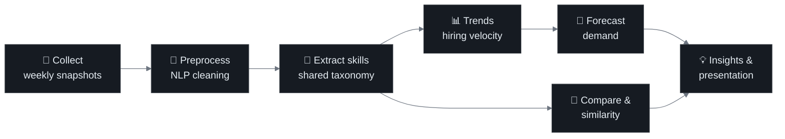

<div align="center">


<br>


[**Roadmap**](#-sprint-roadmap) · [**Data sources**](#-data-sources) · [**Quickstart**](#-quickstart) · [**Repo map**](#-repository-map) · [**Ethics**](#-data-ethics)

</div>

---

## 🎯 Overview

Job postings show what a company plans to do before it shows up in
earnings reports or product launches. This project builds an end-to-end
hiring-intelligence pipeline:



**Colour code** used in every chart and table: 🟠 **Anthropic** · 🟣 **OpenAI** · 🟢 **NVIDIA** · 🔵 **Google**

| | |
|---|---|
| **Problem** | Companies lack a systematic, data-driven way to read competitor hiring and anticipate demand. |
| **Goal** | Use external job-posting data to forecast competitor demand, skill trends, and market direction. |
| **Who it's for** | Strategy, HR & talent, product managers, CTOs, investors. |
| **Team** | Solo: [Frank Mediavilla](https://github.com/FrankPonce), rotating through Scrum Lead, Data Quality, Docs and Tech Lead roles. |
| **Timeline** | 12 weekly sprints · Nov 2026 → Jan 2027 |

**Latest signal:** open roles grew **+52% at Anthropic** and **+29% at OpenAI** between March and November 2026 ([Sprint 5](docs/sprints/sprint-05-hiring-trends.md)).


**How they differ** ([Sprint 6](docs/sprints/sprint-06-competitor-comparison.md)): the skills each company over-indexes on, compared with the other three.


---

## 🗺️ Sprint roadmap

All **10 CadetX tasks + both optional tasks** run as one sprint per week.
Click a sprint to see its goal, deliverables, and results.

| # | Sprint | Week of | Summary | Status |
|:-:|---|:-:|---|:-:|
| 01 | [**Data Sources & Legal**](docs/sprints/sprint-01-data-sources-legal.md) | Nov 9 | Reviewed terms + robots.txt for all four companies, found a compliant route for each, plus CC BY history for two | ✅ |
| 02 | [**Data Collection**](docs/sprints/sprint-02-data-collection.md) | Nov 16 | 4 collectors built; first snapshot of 2,170 postings + 4,111 historical; [Data Collection Reports](reports/data-collection/) | ✅ |
| 03 | [**NLP Preprocessing**](docs/sprints/sprint-03-nlp-preprocessing.md) | Nov 23 | Unified corpus (4,958 postings as of Nov 9); 23–54% boilerplate removed; sections, salary, spaCy lemmas; [summary](reports/preprocessing/summary.md) | ✅ |
| 04 | [**Skill Extraction**](docs/sprints/sprint-04-skill-extraction.md) | Nov 30 | 211-skill shared taxonomy; 45k skill mentions; role family, seniority, education features; 89% precision; [summary](reports/skills/summary.md) | ✅ |
| 05 | [**Hiring Trends**](docs/sprints/sprint-05-hiring-trends.md) | Dec 7 | Open roles +52% Anthropic / +29% OpenAI since March; weekly velocity, role-mix shifts, emerging skills; [summary](reports/trends/summary.md) | ✅ |
| 06 | [**Competitor Comparison**](docs/sprints/sprint-06-competitor-comparison.md) | Dec 14 | Fair two-lens framework; Anthropic = safety + GTM, OpenAI = APIs/platform, NVIDIA = HPC stack, Google = TPU/research; [summary](reports/comparison/summary.md) | ✅ |
| 07 | [**Demand Forecasting**](docs/sprints/sprint-07-demand-forecasting.md) | Dec 21 | Baselines → ARIMA / Prophet with backtesting and honest intervals | 🟡 |
| 08 | [**Similarity Scoring**](docs/sprints/sprint-08-similarity-scoring.md) | Dec 28 | TF-IDF + Sentence-BERT similarity, role clusters, heatmaps | ⬜ |
| 09 | [**Insights & Reporting**](docs/sprints/sprint-09-insights-reporting.md) | Jan 4 | Decision-ready findings per company and across the landscape | ⬜ |
| 10 | [**Automated Pipeline**](docs/sprints/sprint-10-automated-pipeline.md) <sub>optional</sub> | Jan 11 | One scheduled end-to-end pipeline | ⬜ |
| 11 | [**Fine-Tuned Skill Model**](docs/sprints/sprint-11-fine-tuning.md) <sub>optional</sub> | Jan 18 | BERT/RoBERTa token classifier vs. rule-based baseline | ⬜ |
| 12 | [**Final Presentation**](docs/sprints/sprint-12-final-presentation.md) | Jan 25 | Mentor review, final deck, polished repo | ⬜ |

<sub>✅ done · 🟡 in progress · ⬜ not started · Weekly notes live in <a href="docs/weekly-notes/">docs/weekly-notes/</a></sub>

---

## 🏢 Data sources

Each company has a documented, compliant route. Full evidence is in
[`source-register.csv`](docs/source-register.csv) and the
[Sprint 1 review](docs/sprints/sprint-01-data-sources-legal.md).

| Company | ATS | Current postings | History |
|---|---|---|---|
| 🟠 **Anthropic** | Greenhouse | [Job Board API](https://docs.greenhouse.io/job-board.html) (public, documented) | [Epoch AI](https://epoch.ai/data/frontier-lab-hiring) archive since Mar 2026 · CC BY |
| 🟣 **OpenAI** | Ashby | [Posting API](https://developers.ashbyhq.com/docs/public-job-posting-api) (public, documented) | [Epoch AI](https://epoch.ai/data/frontier-lab-hiring) archive since Mar 2026 · CC BY |
| 🟢 **NVIDIA** | Workday | Sitemap-listed job pages (path allowed by robots.txt) | Own weekly snapshots |
| 🔵 **Google** | Google Careers | Unpaginated results pages, newest-first slices | Own weekly snapshots |

> [!NOTE]
> A single snapshot isn't a time series. Snapshots began on 2026-11-08: all
> companies every Monday, and NVIDIA again every Thursday. Forecasts for NVIDIA
> and Google rely on that short history and are labelled accordingly.

**Latest snapshot · 2026-11-09** · corpus of **4,958** unique postings

| 🟠 Anthropic | 🟣 OpenAI | 🟢 NVIDIA | 🔵 Google | Epoch history |
|:-:|:-:|:-:|:-:|:-:|
| **675** | **813** | **99** | **582** | **4,114** |
| full board | full board | newest ~5 days | AI/ML sample | Mar → Nov 2026 |

---

## ⚡ Quickstart

```bash
python -m venv .venv
.venv\Scripts\activate          # macOS/Linux: source .venv/bin/activate
pip install -r requirements.txt
python -m spacy download en_core_web_sm

python -m src.collect.epoch_history          # Anthropic + OpenAI history (CC BY)
python -m src.collect.run_snapshot           # weekly snapshot, all four companies
python -m src.collect.run_snapshot nvidia --limit 3   # quick test, saves nothing
python -m src.preprocess.build_corpus        # cleaned corpus -> data/processed/corpus/
python -m src.features.build_features       # skills + features -> data/features/
python -m src.trends.build_trends           # weekly trends + charts -> data/trends/, reports/trends/
python -m src.compare.build_comparison      # competitor comparison -> data/comparison/, reports/comparison/
python -m pytest                             # 48 regression tests
```

Snapshots land in `data/raw/<company>/<date>.*`. Merged per-company datasets
(with `first_seen_date`, `last_seen_date`, `job_status`) go to
`data/processed/<company>.csv`. A text-free run log is committed to
[`reports/collection-log.csv`](reports/collection-log.csv).

---

## 📁 Repository map

```text
├── docs/
│   ├── sprints/              one page per sprint (goal · deliverables · results)
│   ├── weekly-notes/         weekly progress notes
│   ├── data-dictionary.md    shared schema for all four companies
│   └── source-register.csv   legal / access review evidence
├── src/
│   ├── collect/              collectors · validation · snapshot runner
│   ├── preprocess/           sections · boilerplate removal · spaCy · corpus builder
│   ├── features/             skill taxonomy · extractors · feature tables
│   ├── trends/               weekly flows · emerging skills · charts
│   └── compare/              two-lens competitor comparison
├── data/
│   ├── raw/                  weekly snapshot CSVs per company (full text)
│   ├── external/             Epoch AI download (CC BY)
│   ├── processed/            per-company datasets · Epoch history · corpus/ (cleaned, per company)
│   ├── features/             posting features · skills (long) · skill matrix
│   ├── trends/               weekly / monthly trend tables
│   └── comparison/           company profiles · distinctive skills · mixes
├── tests/                    regression tests (compliance rules, parsing, skill matching)
├── assets/                   banner and visual identity
├── notebooks/                exploration & analysis
├── reports/                  run logs, collection reports, insight reports
└── presentations/            final deck
```

---

## 🛡️ Data ethics

- **Documented routes only.** Terms and robots.txt are reviewed per source and re-checked before runs. Public APIs are preferred over scraping.
- **Gentle.** Weekly cadence, rate-limited, with an identifying User-Agent. Never paginate where robots.txt forbids it.
- **No personal data.** Posting content only. Emails and phone numbers are scrubbed automatically.
- **Open data, with attribution.** Datasets are committed so the work can be inspected and reproduced. Every row keeps its source URL, and data is removed promptly if a source owner asks.
- **Attribution.** History for Anthropic and OpenAI comes from Epoch AI, "Data on Frontier Lab Hiring", [epoch.ai](https://epoch.ai/data/frontier-lab-hiring) (CC BY).

<div align="center">
<br>
<sub>Built for the CadetX Virtual Work Experience · Competitor Demand Prediction Using Job Postings</sub>
</div>
