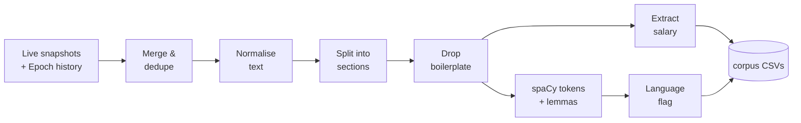

# Sprint 3 — NLP Preprocessing & Method Selection

**Week of:** 2026-11-23 (done early, 2026-11-09) · **CadetX task 3** · **Status:** ✅ Done

## Goal

Clean and structure every job description so the four companies' text is
comparable, and pick the methods later sprints build on.

## CadetX deliverables

- [x] Cleaned & preprocessed job-posting text: [`data/processed/corpus/`](../../data/processed/corpus/), one CSV per company (4,909 postings at sprint close; 4,958 after the 2026-11-09 snapshot). Browsable sample: [`corpus_sample.csv`](../../data/processed/corpus_sample.csv)
- [x] Documented preprocessing workflow + code in GitHub: this page · [`src/preprocess/`](../../src/preprocess/) · generated [preprocessing summary](../../reports/preprocessing/summary.md)

## Results

| Company | Postings | Text removed as boilerplate | Median tokens | Responsibilities found | Requirements found | Salary parsed |
|---|---:|---:|---:|---:|---:|---:|
| Anthropic | 1,839 (675 live + 1,164 history) | 54% | 344 | 98% | 96% | 73% |
| OpenAI | 2,391 (816 live + 1,575 history) | 44% | 346 | 96% | 90% | 28%¹ |
| NVIDIA | 100 | 23% | 296 | 96% | 96% | 59% |
| Google | 579 | 26% | 264 | 95% | 100% | 0%² |

¹ 80% of live OpenAI postings carry pay; Epoch history doesn't. ² Google's results pages don't include pay for most roles.

Run with `python -m src.preprocess.build_corpus` (~3–6 min on a laptop).

## Pipeline

| Step | What it does | Why |
|---|---|---|
| **1. Merge & dedupe** | Live snapshots + Epoch history joined on `job_id` (IDs match exactly: 619 Anthropic and 753 OpenAI overlaps). Keeps the earliest `first_seen_date`. History-only postings get `job_status = closed` and a rebuilt URL | One row per real posting, with the longest possible history for Sprint 5 |
| **2. Normalise** | Unicode NFKC, curly quotes → straight, dashes, bullets → line breaks, URLs stripped, whitespace collapsed | Consistent tokens across four different sources |
| **3. Section split** ([`sections.py`](../../src/preprocess/sections.py)) | ~40 heading patterns catalogued from the corpus, mapped to `intro` · `about` · `responsibilities` · `requirements` · `preferred` · `boilerplate`. Handles line headings (Anthropic, OpenAI, Google) and inline ones in flattened text (NVIDIA: "...GPUs) What we need to see: ...") | Skills in *requirements* vs. *preferred* mean different things; Sprint 4 can weight them |
| **4. Drop boilerplate** ([`clean.py`](../../src/preprocess/clean.py)) | (a) Drops whole sections like "About Anthropic", "Logistics", "Annual Salary", EEO and benefits. (b) **Data-driven:** sentences repeated across ≥3% of a company's postings (min 5) are templates. They are removed from intro/about sections, and removed from role sections only when they mention the company, pay or legal terms, or don't read like a requirement | Up to 54% of raw text is identical company/legal copy. Left in, it would dominate TF-IDF and make every company look like itself instead of like its roles. The requirement guard keeps real, common requirements such as "Bachelor's degree or equivalent practical experience." |
| **5. Salary** | Parses USD ranges ("$185K – $325K", "$141,000-$202,000", "184,000 USD - 356,500 USD") into `salary_min` / `salary_max`. Multi-location postings take the overall min/max | Fills the brief's `salary_range` field where no structured value exists |
| **6. Tokens** | spaCy `en_core_web_sm` (parser and NER off): lower-cased lemmas, minus stop words, punctuation and numbers. Protects tech terms (`C++`, `C#`, `.NET`, `CI/CD`, `Node.js`…) and keeps `c` / `r` | `cleaned_description` feeds TF-IDF and skill matching in Sprints 4 and 8 |
| **7. Language** | `en` / `mixed` / `other`, from English stop-word share, foreign function words and CJK characters | 6 bilingual EU postings (English + French/Spanish/Italian) and 1 French-only. Kept but flagged so later sprints can filter |

## Method selection (for later sprints)

| Use | Text field | Method |
|---|---|---|
| Skill extraction (Sprint 4) | `section_requirements`, `section_preferred`, `section_responsibilities` | Taxonomy + spaCy PhraseMatcher on readable text, so multi-word skills like "distributed training" survive |
| TF-IDF / keyword trends (Sprints 4–6, 8) | `cleaned_description` | Lemmatised tokens, n-grams 1–2 |
| Embeddings / similarity (Sprint 8) | `clean_text` | Sentence-BERT on natural text; no lemmatising, because transformers prefer real sentences |
| Time series (Sprints 5, 7) | `first_seen_date`, `last_seen_date`, `job_status` | Weekly buckets |

Two text forms are kept on purpose: `clean_text` (readable, boilerplate-free) and
`cleaned_description` (lemmatised tokens). Each later method uses the one that suits it.

## Output schema additions

See [`data-dictionary.md`](../data-dictionary.md#sprint-3-corpus-dataprocessedcorpusparquet) for every column.

## Decisions & limitations

- **Boilerplate threshold** (3% of a company's postings, min 5) was tuned by inspection. NVIDIA's small sample (100) makes it the noisiest company here.
- **Heading coverage:** 4–10% of postings have no detected requirements section. Their content stays in `intro`/`about`, so nothing is lost, it's just unlabelled.
- **Inline heading matching** adds a few false positives (~0.4% of docs, checked on 900) where a heading phrase with a colon appears mid-paragraph.
- **Lower-casing** merges "Go" (language) with "go" (verb) in `cleaned_description`. Sprint 4's skill matcher works on case-preserved `clean_text` to avoid this.
- **Storage (updated 2026-11-09):** the corpus is committed as per-company CSVs, which git delta-compresses to about 1 MB per weekly change. A 30 MB Parquet version is kept only as a local cache, because binary files don't compress between versions and would have grown the repo by about 30 MB every week. Load it with `load_corpus()`.

---

[← Back to README](../../README.md)
