# Sprint 5 — Hiring Trend Analysis

**Week of:** 2026-12-07 (done early, 2026-11-09) · **CadetX task 5** · **Status:** ✅ Done

## Goal

Aggregate postings over time, measure hiring velocity, and find growth,
slowdowns and shifts, using one time-series structure shared by all four
companies.

## CadetX deliverables

- [x] Trend-analysis tables & visual summaries: [`data/trends/`](../../data/trends/) · [generated summary with charts](../../reports/trends/summary.md)
- [x] Short note on the key hiring patterns observed: [Key patterns](#key-patterns) below

## Shared time-series structure

Every company uses the same weekly frame ([`weekly_company.csv`](../../data/trends/weekly_company.csv)):

| Field | Meaning |
|---|---|
| `week` | Monday of the ISO week (complete weeks only) |
| `new_postings` | Postings **first seen** that week: the hiring flow |
| `closed` | Postings last seen that week that are no longer open |
| `active` | Postings open at any point in the week: the stock |
| `new_4wk_avg` | 4-week rolling mean of `new_postings`: the headline velocity |
| `net_change` | `new_postings − closed` |
| `hiring_velocity_bucket` | low / medium / high vs. the company's own weekly terciles |
| `scrape_days`, `low_coverage` | Data-quality flags (see Limitations) |

Per-posting fields from the brief are in [`posting_trend_fields.csv`](../../data/trends/posting_trend_fields.csv):
`posting_week`, `posting_month`, `hiring_velocity_bucket`, `emerging_skill_flag`.

**Validation:** our computed stock for Anthropic ends at 675 active postings,
against Epoch's own count of 673 open roles. The flow logic agrees with an
independent count.

## Key patterns

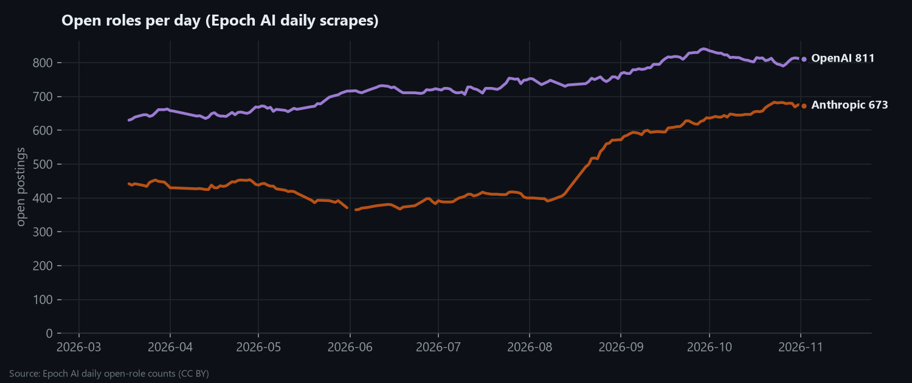

**1. Both labs grew their open roles, Anthropic much faster.**
Between 2026-03-18 and 2026-11-02, Anthropic went from 442 to 673 open roles (+52%) and OpenAI from 630 to 811 (+29%).
New postings average about **42/week at Anthropic** and **53/week at OpenAI**. Most postings stay up about 40 days
(median 39 days at Anthropic, 41 at OpenAI).

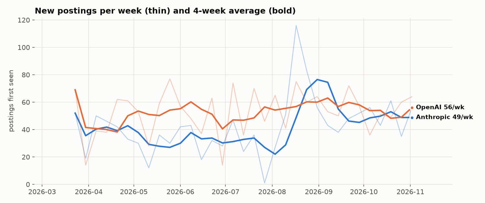

**2. Anthropic paused, then surged.**
Anthropic's 4-week average fell to **22 new postings/week** in early August, then hit **77/week** by the end of August.
The by-category view shows where it went: go-to-market openings fell from 179 to 84 (Aug 8), then rose to 226 by late
October. Corporate roles doubled (80 → 194), and compute (34 → 86) and research (73 → 121) also climbed.
OpenAI's velocity was steadier (4-week average between 38 and 69).

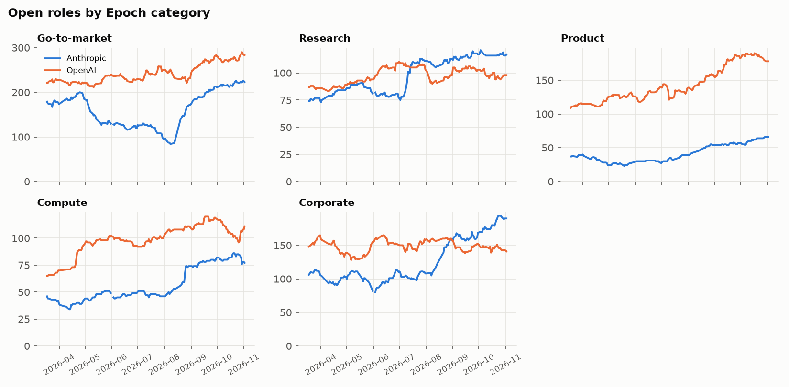

**3. OpenAI is building product and compute.**
OpenAI's product openings rose from 109 to 178 (peak 190) and compute from 65 to 111. Go-to-market grew too (221 → 283),
but as a *share of new postings* sales/GTM fell 3.5 pp. Marketing & communications (+2.8 pp), data center &
facilities (+1.8 pp) and ML/AI engineering (+1.7 pp) took that share.

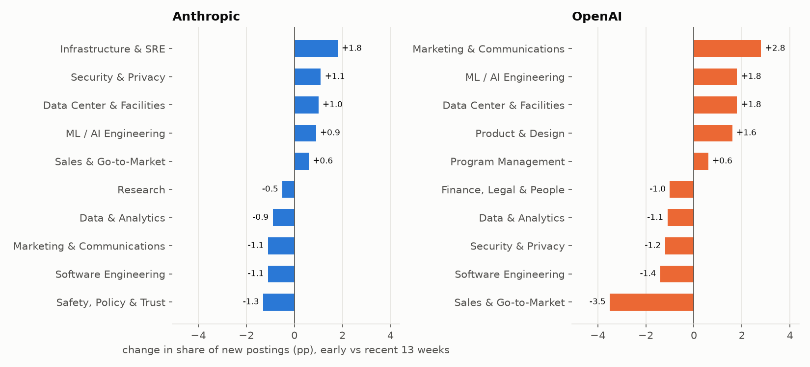

**4. Anthropic's mix tilted to infrastructure and security:** Infrastructure & SRE +1.8 pp, Security & Privacy
+1.1 pp, Data Center & Facilities +1.1 pp. Safety/policy and marketing shares eased slightly
(−1.2 pp each) while their absolute counts still grew.

**5. Emerging skills point to physical build-out and the public sector.**
These are the skills that grew most in new postings between the first and last 13 weeks (Anthropic + OpenAI).
The flagged ones (≥ +2 pp and ≥1.5× growth) are:

| Skill | Early → recent share |
|---|---|
| Government & Public Sector | 6% → 9% |
| Data Center Design & Construction | 5% → 8% |
| Identity & Access | 2% → 5% |
| LLM APIs | 3% → 6% |
| Commissioning | 3% → 5% |

AI Agents (14% → 17%) and Account Management (12% → 15%) grew the most in absolute terms, but from a high base.

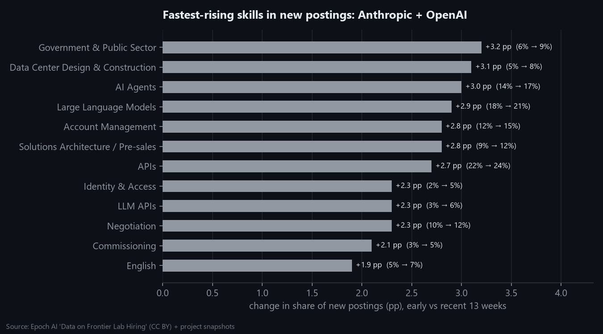

**6. NVIDIA and Google: too early for a trend.**
Our two snapshots (Nov 8 and 9) show NVIDIA's sitemap turning over about 25–30 postings in a day, so it posts roughly
20+ roles a day. Google's published dates only cover roles still open, so older weeks look small because those
roles already closed (survivorship). These two companies get real weekly flows as snapshots accumulate.

## How it's built

`python -m src.trends.build_trends` ([code](../../src/trends/build_trends.py)) reads the Sprint 4 features plus
Epoch's daily open-role counts and writes:

| File | Content |
|---|---|
| `weekly_company.csv` | Weekly new / closed / active, 4-week average, velocity bucket, coverage flags |
| `epoch_open_roles_daily.csv` | Daily open roles by lab × category (Epoch AI, CC BY) |
| `monthly_role_family.csv` | New postings per month by role family |
| `role_family_shift.csv` | Role-family share of new postings, early vs. recent 13 weeks |
| `emerging_skills.csv` | Skill share change, early vs. recent, per company and combined, with `emerging_skill_flag` |
| `posting_lifetime.csv` | Median days open for closed postings, by company and role family |
| `nvidia_google_recent_published.csv` | Open postings by week published (NVIDIA, Google) |
| `posting_trend_fields.csv` | Per-posting `posting_week`, `posting_month`, `hiring_velocity_bucket`, `emerging_skill_flag` |

Charts use one fixed, colour-blind-checked colour per company (Anthropic blue, OpenAI orange, NVIDIA aqua,
Google yellow), with direct labels. Every chart has a table version in the summary.

## Snapshot #2 and pipeline hardening

The second snapshot (2026-11-09) ran into a temporary DNS outage. It was rerun, and the collector now:

- retries connection errors with backoff, and
- **refuses to save a snapshot when more than 5% of fetches fail**, because missing postings would otherwise be
  recorded as "closed".

The weekly merge now has real history: 1,170 Anthropic and 1,583 OpenAI postings are marked closed.

## Addendum (2026-11-09): longer history, untracked signals, geography, pay

Added after the project review to address three weaknesses: short history, uneven data, and a
taxonomy-only view of skills.

### A. Multi-year history from the Internet Archive

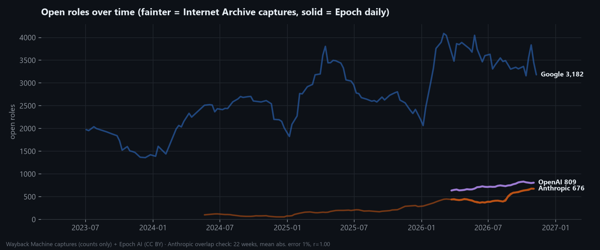

[`src/collect/wayback_history.py`](../../src/collect/wayback_history.py) reads archived copies of public careers
pages (research use under the Internet Archive's terms, about 1 request every 4 s) and keeps **only the
open-roles count** per capture. One capture per week: 150 for Google (2023–26), 103 for Anthropic (2024–26).

- **Validated:** across the 22 weeks where archive and Epoch overlap (Anthropic), the archive counts are within
  **1.2% on average (r = 0.997)** of Epoch's daily counts.
- 🟠 **Anthropic** grew from about 74 open roles (Q4 2024) to **667** (Q4 2026), about 9× in two years, accelerating
  through 2025–26.
- 🔵 **Google** went from about 1,950 open roles (mid-2023) to about 3,400 (2026), with a **clear yearly cycle**:
  peaks in spring and troughs around December–January. Sprint 7 can model this seasonality.
- 🟣 OpenAI's pages render jobs client-side and 🟢 NVIDIA's board isn't archived, so their history stays shorter
  (see C).

Files: [`data/history/wayback_open_roles.csv`](../../data/history/wayback_open_roles.csv) ·
[`open_roles_long.csv`](../../data/history/open_roles_long.csv)

### B. Emerging signals the taxonomy missed

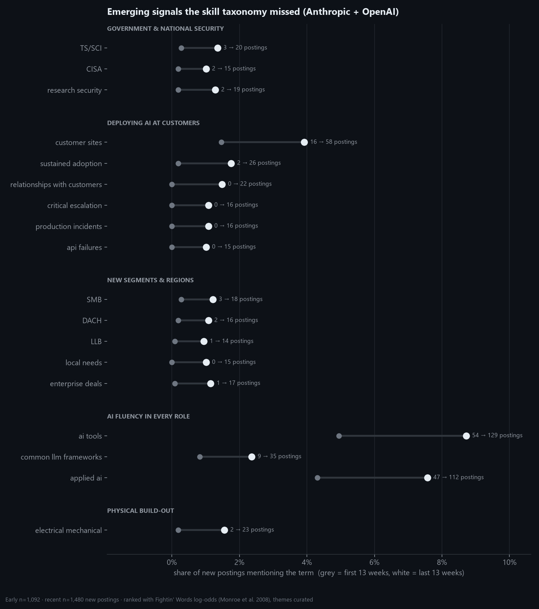

[`src/trends/emerging_terms.py`](../../src/trends/emerging_terms.py) ranks 1–3-word phrases in the role text of new
postings (first vs last 13 weeks, Anthropic + OpenAI) with the *Fightin' Words* weighted log-odds method
(Monroe, Colaresi & Quinn, 2008). Single words count only if they behave like names or technical terms. Each term is
checked against the Sprint 4 taxonomy. The chart groups the strongest **untracked** risers into themes; the full
ranking (8,000+ terms) is in [`emerging_terms.csv`](../../data/trends/emerging_terms.csv).

| Theme | Evidence | Reading |
|---|---|---|
| Government & national security | **TS/SCI** 3 → 20 postings, CISA, research security | Push into classified / defence work |
| Deploying AI at customers | customer sites 16 → 58, sustained adoption 2 → 26, critical escalation, production incidents, API failures | Shift from *selling* to *deploying and operating* AI at customers |
| New segments & regions | SMB, DACH, LLB (non-US law degree), local needs | Mid-market and European / international expansion |
| AI fluency in every role | "ai tools" 54 → 129 postings | AI-tool proficiency becoming a baseline requirement |
| Physical build-out | electrical/mechanical 2 → 23 | Data-center construction |
| *Falling* | "GTM strategy", "strategic vision", "fast-moving environments" | Less strategy-speak, more execution |

### C. Geographic footprint and expansion signals

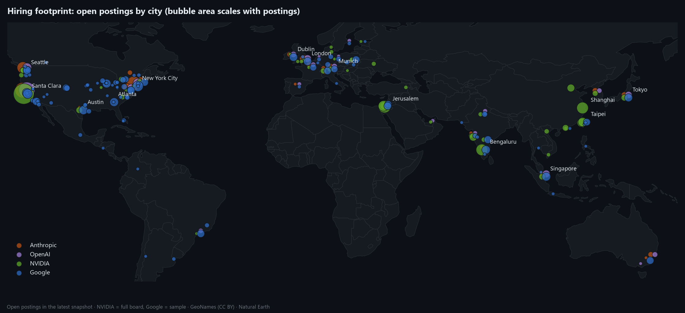

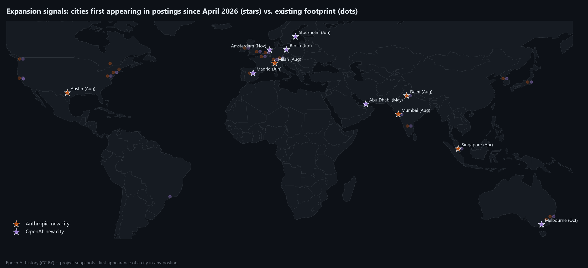

[`src/trends/geo_pay.py`](../../src/trends/geo_pay.py) geocodes every posting location (GeoNames, CC BY;
Natural Earth outlines). An **expansion signal** is a city's first appearance in a company's postings after the
first two weeks of history.

| When | 🟠 Anthropic | 🟣 OpenAI |
|---|---|---|
| Apr | Singapore | |
| May | | Abu Dhabi |
| Jun | | Madrid, Stockholm, Berlin |
| Aug | Mumbai, Delhi, Milan, Austin | |
| Oct–Nov | | Melbourne, Amsterdam |

Anthropic's Asian and European cities appear in **August**, the same weeks its go-to-market openings surged
(pattern 2 above). OpenAI's Gulf and European expansion came earlier, in **May–June**. These dates are the
raw material for Sprint 7's leading-indicator tests.

### D. Pay trends

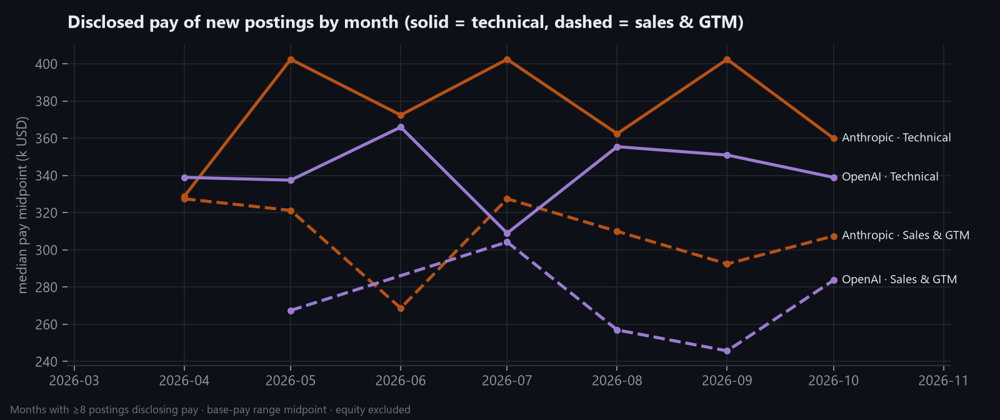

Disclosed base-pay midpoints of new postings by month (Anthropic + OpenAI; months with ≥8 disclosing postings,
partial current month excluded) in [`pay_trend_monthly.csv`](../../data/trends/pay_trend_monthly.csv). Anthropic's
technical roles pay a steady **~$360–400k** median midpoint, above OpenAI's ~$310–365k. Sales & GTM sits about
$50–100k lower at both. There's no clear upward drift over 2026: the hiring surge was about more roles, not higher pay.

### E. NVIDIA: requisitions per day from the ID sequence

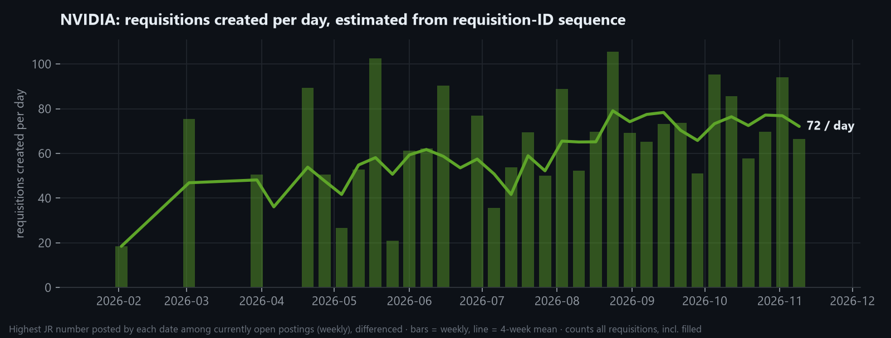

NVIDIA's board isn't archived, and its posted dates refresh often (about 73% of open postings show a date in the
last six weeks). Its **requisition IDs**, though, are issued in sequence (JR2028597 → JR2029722). Among the 2,799
open postings, the highest JR number posted by each date tracks NVIDIA's requisition counter. Differencing it gives
**requisitions created per day**, including ones since filled (the "German tank" estimator;
[`history.py`](../../src/trends/history.py)). Only weeks with at least 5 surviving postings are used, from late January 2026.

- Requisition creation **rose from about 45–55 a day in spring to 70–80 a day in autumn 2026** (4-week mean 72/day in
  the latest week, roughly 25,000 a year), so NVIDIA's hiring activity is accelerating. That's company-wide hiring activity, including internal and unadvertised requisitions, so read it as an
  activity index, not a count of posted jobs.
- Weekly snapshots from now on add the direct view (new and closed postings) to cross-check it.

## Limitations

- **Epoch scrape gaps.** Daily scrapes skip some days (up to 8, e.g. Apr 2–10 and Aug 14–20). Postings published in a
  gap are first seen on the next scrape, so single weeks are lumpy (the Aug 17 week partly reflects catch-up).
  Use the 4-week average. Weeks with fewer than 4 scrape days are flagged `low_coverage`.
- **Left-censoring.** Everything open on 2026-03-18 counts as "first seen" that day, so that week is excluded
  from flows.
- **Current week excluded.** Only complete Monday–Sunday weeks are used.
- **`active` ≠ point-in-time open roles.** It counts postings open *at any point* in the week, so it runs a bit higher than
  Epoch's daily count.
- **NVIDIA "closed"** only means "dropped out of the newest-100 sitemap window", not necessarily filled.

---

[← Back to README](../../README.md)
