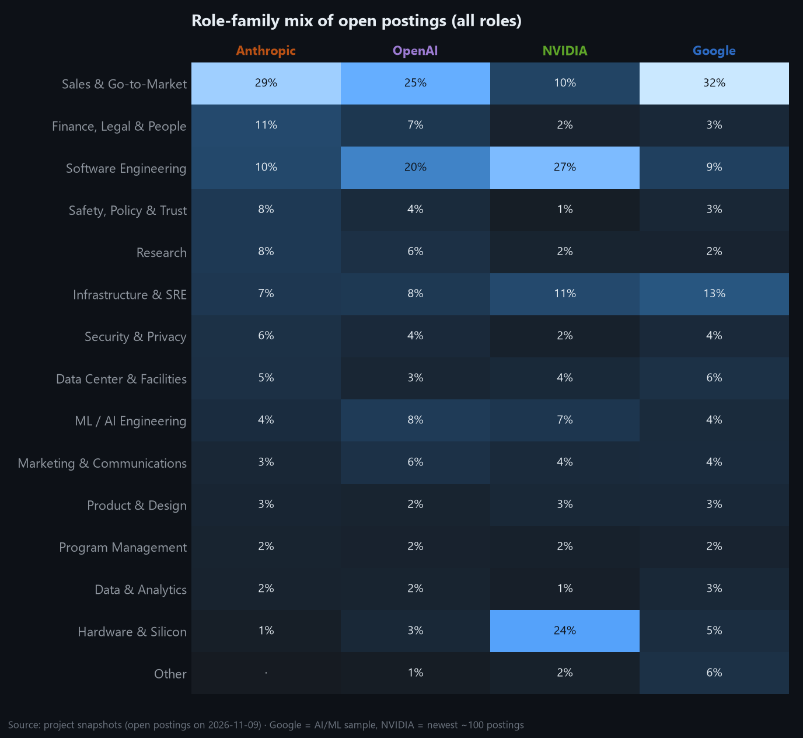
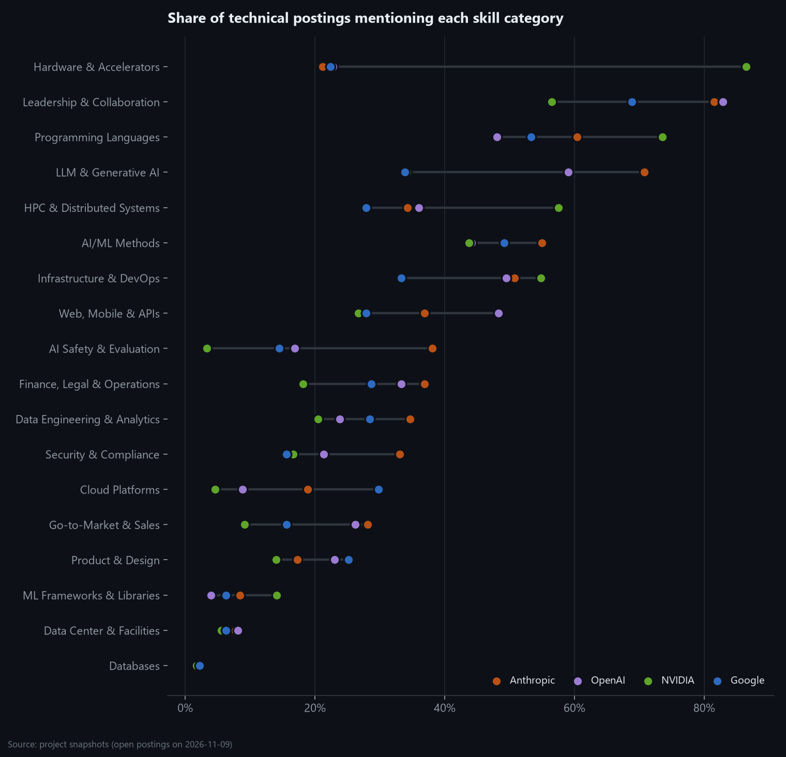
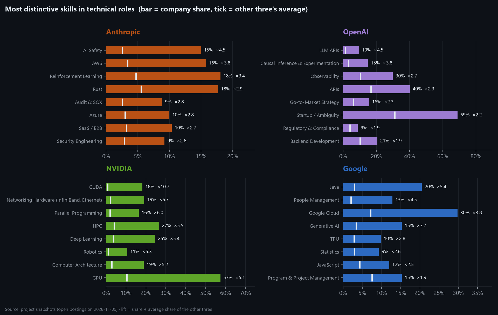
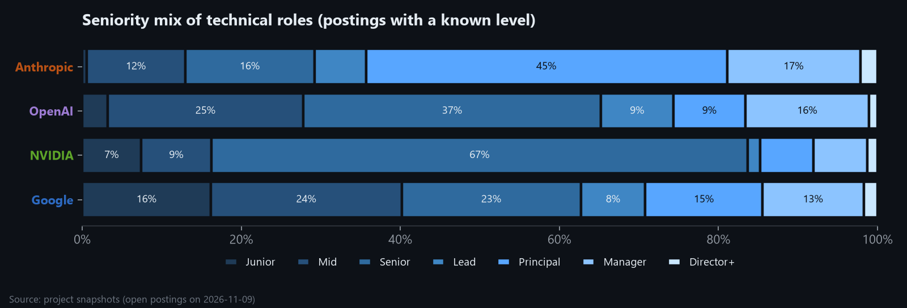
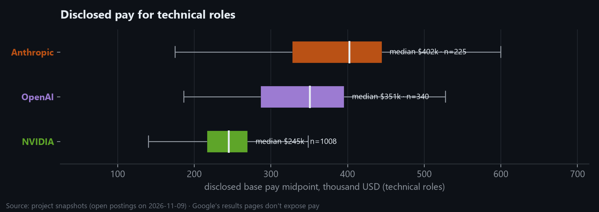
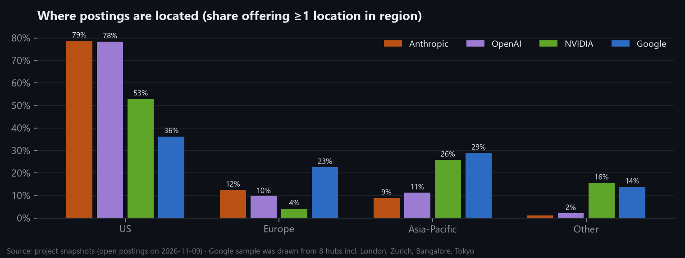

# Sprint 6 — Competitor Comparison

**Week of:** 2026-12-14 (done early, 2026-11-09) · **CadetX task 6** · **Status:** ✅ Done

## Goal

Compare 🟠 Anthropic, 🟣 OpenAI, 🟢 NVIDIA and 🔵 Google on skills, role mix,
seniority, pay, location and hiring velocity, within one shared framework,
to surface similarities, differences and strategic gaps.

## CadetX deliverables

- [x] Comparison tables & visuals: [`data/comparison/`](../../data/comparison/) · [generated summary with charts](../../reports/comparison/summary.md)
- [x] A short explanation of how each company compares: [Company by company](#company-by-company) below

## The comparison framework

The four datasets were collected differently, so a naive side-by-side would mostly
compare *sampling methods*. The framework controls for that:

| Rule | Why |
|---|---|
| **Same point in time:** postings open in the latest snapshot (2026-11-09) | Removes the history imbalance (Anthropic/OpenAI have Epoch history; NVIDIA/Google don't) |
| **Shares, never counts** | Board sizes and samples differ, so "% of a company's postings" is comparable |
| **Lens A: all roles** | Like-for-like for Anthropic vs OpenAI (full boards). Indicative only for NVIDIA (newest ~100) and Google (AI/ML sample) |
| **Lens B: technical roles** (ML/AI, research, software, infra, hardware, data, security) | Like-for-like across all four: NVIDIA 2,059 · OpenAI 408 · Google 366 · Anthropic 260 postings |
| **Distinctiveness = lift vs the *average* of the other three** | Each competitor weighs equally, so a big board doesn't define "normal" |

> **Revised 2026-11-09 with better data.** This page was first written with NVIDIA's newest ~100 postings and a
> keyword-biased Google sample. Both were fixed (Sprint 2 update): NVIDIA is now the **full board (2,799)**, and
> Google is an **unbiased hub × seniority sample (917)**. The first version overstated Google's AI focus (60% →
> 40% technical, PhD mentions 64% → 45%). Remaining caveat: Google's v2 sample takes the same number of postings
> per hub, so its **location mix reflects the sampling design**, not Google's real geography.

## At a glance

| | 🟠 Anthropic | 🟣 OpenAI | 🟢 NVIDIA | 🔵 Google |
|---|---:|---:|---:|---:|
| Open postings (all roles) | 675 | 813 | 2,799 | 917 (sample) |
| Technical share of postings | 39% | 50% | 74% | 40% |
| Sales & GTM share (lens A) | 29% | 25% | 10% | 32% |
| Median min. years, tech roles | 7 | 7 | 5 | 3 |
| PhD mentioned / required, tech | 5% / 3% | 3% / 3% | 29% / 26% | 45% / 6% |
| "Or equivalent experience" accepted, tech | 8%¹ | 12% | 80% | 93% |
| People managers (all roles) | 19% | 15% | 11% | 13% |
| Median disclosed pay midpoint, tech roles | **$402k** | $351k | $245k | n/a² |
| Skills phrased as *preferred* (nice-to-have) | 36% | **7%** | 29% | 35% |

¹ Anthropic states its degree policy in a standard "Logistics" block that Sprint 3 removes as boilerplate, so this undercounts. ² Google's results pages rarely expose pay (2% of tech postings).

## Company by company

### 🟠 Anthropic: safety-first, senior-heavy, scaling go-to-market

- **Role mix:** the most commercial of the four. 29% of open postings are sales/GTM and 11% finance, legal & people,
  while only 39% are technical. Combined with Sprint 5 (open roles +52% since March, GTM rebuilt from 84 to 223
  openings), Anthropic is building out its company and sales capacity fast.
- **Distinctive skills (tech roles):** AI Safety (15% vs 3% for the others) and AI Safety & Evaluation overall (38% vs
  ≤24%) are clearly distinctive, matching its positioning. Also Rust (18% vs 6%), reinforcement learning (18% vs 7%),
  and **multi-cloud**: AWS 16% and Azure 10%, against 5% and 3% elsewhere (Claude ships on several clouds).
  Security & compliance is high too (33% of tech postings).
- **Seniority:** 45% of technical roles with a known level are Principal/Staff, almost all from explicit "Staff+"
  titles. It also has the highest people-manager share (19%).
- **Pay:** highest disclosed technical pay (median midpoint about $402k).
- **Gaps:** low on C++ (7% vs 27%) and Linux (6% vs 17%). Systems-level and hardware work is a small part of its
  hiring.

### 🟣 OpenAI: product & platform engineering, API-centric

- **Role mix:** the largest board, and the most **software-engineering-heavy** of the full boards (20% of postings vs
  10% at Anthropic). Sales/GTM is still big (25%), but Sprint 5 showed its share of new postings falling while
  product, compute and marketing grow.
- **Distinctive skills:** APIs (40% vs 17%), backend development (21% vs 8%), observability (30% vs 14%), LLM APIs
  (10% vs 1%) and causal inference / experimentation (15% vs 4%). That's the profile of a company running consumer
  and developer **products at scale**, with an A/B testing culture.
- **Culture signal:** "fast-paced / ambiguity" language in 69% of tech postings (vs 34% for the others).
- **Framing:** only 7% of skill mentions are phrased as nice-to-haves (vs 28–37% elsewhere). OpenAI postings state
  what they need and rarely list preferences.
- **Gaps:** low on GPU (10% vs 27%), C++ and Google Cloud. Compute hiring sits in its own infrastructure teams rather
  than spread across roles.

### 🟢 NVIDIA: the hardware & HPC stack

- **Role mix (full board, 2,799):** 74% technical. Software engineering 27%, **hardware & silicon 24%**,
  infrastructure 11%; sales 10%; almost no corporate or safety roles. 219 university postings (interns/new grads).
- **Distinctive skills:** the accelerated-computing stack. GPU (57% vs 10%), CUDA (18% vs 1%), InfiniBand/Ethernet
  networking (19% vs 2%), HPC (27% vs 4%), computer architecture (19% vs 3%), NVLink/PCIe/CXL (12% vs 2%), parallel
  programming (16% vs 2%), EDA tools (10% vs 1%), plus **robotics (11% vs 1%)**, NVIDIA's physical-AI push.
- **Seniority & credentials:** 60% Senior-titled. The highest PhD *requirement* (26% of tech roles), yet 80% accept
  "or equivalent experience". Median disclosed pay about $245k (US roles), the lowest of the three that disclose,
  likely because its board covers far more mid-level and hardware roles.
- **Geography:** Santa Clara 47%, then Israel 15%, India 9%, China 9%, Taiwan 5%: the most Asia-weighted footprint.
- **Gaps:** low on "fast-paced/ambiguity" language (15% vs 49%), distributed systems and SRE. NVIDIA builds the
  platform rather than running consumer services on it.

### 🔵 Google: Cloud selling, GenAI and a deep management layer

- **Role mix (unbiased sample):** only 40% technical. **Sales & GTM 32%**, the highest of the four, which reflects
  Google Cloud's enterprise sales machine. Infrastructure 13%, software 9%.
- **Distinctive skills:** Google Cloud (30% vs 7%), Java (20% vs 3%), **Generative AI (15% vs 3%)** and TPU (10% vs 3%),
  so its GenAI push is real even without keyword sampling. Also statistics and data analysis, and the strongest
  **management layer**: people management (13% vs 2%), program management (15% vs 7%), product management (17% vs 9%).
- **Credentials:** PhD mentioned in 45% of technical postings but required in only 6%; 93% accept "or equivalent
  experience"; lowest median minimum years (3). Google hires across the most levels (Junior 15%, Mid 23%).
- **Gaps:** low on GPU (6% vs 28%, since Google uses its own TPUs), APIs and observability. Google's internal tool names
  don't match the external vocabulary in the taxonomy.

## Similarities and strategic gaps

**Shared ground** (share of technical postings):
- Python 39–54%.
- AI agents 17–34%: highest at the two labs, but agentic AI appears in roughly 1 in 6 technical postings even at NVIDIA and Google.
- Infrastructure & DevOps 33–55%.
- Distributed systems 10–25%.

**Where they diverge:**

| Dimension | Leaders | Laggards | Reading |
|---|---|---|---|
| AI safety & evaluation | 🟠 Anthropic 38% | 🟢 NVIDIA 3% | Safety is a core hiring axis only at Anthropic (OpenAI 17%, Google 14%) |
| Hardware & accelerators | 🟢 NVIDIA 86% | 🟠 Anthropic 21% | Labs buy compute; NVIDIA builds it (Google: TPU in-house) |
| APIs & backend platforms | 🟣 OpenAI 40% APIs | 🔵 Google 9% | OpenAI's product-platform focus |
| Go-to-market build-out | 🔵 Google 32%, 🟠 Anthropic 29% of roles | 🟢 NVIDIA 10% | Anthropic's sales build-out is now Google-Cloud-scale *as a share* |
| Credential flexibility | 🔵 Google / 🟢 NVIDIA ~90% "or equivalent" | Labs (stated less often) | Different ways of writing requirements |

## How it's built

`python -m src.compare.build_comparison` ([code](../../src/compare/build_comparison.py)) reads the Sprint 4
features and writes:

| File | Content |
|---|---|
| `company_profiles.csv` | The "at a glance" metrics per company |
| `role_family_mix.csv` | Lens A role-family shares |
| `skill_category_share_tech.csv` | Lens B category shares |
| `distinctive_skills.csv` | Share, other-three average, lift, gap (pp), `distinctive` / `under_indexed` flags for every skill × company |
| `seniority_mix_tech.csv` | Lens B seniority shares |
| `skill_emphasis.csv` | Share of skill mentions in requirements / preferred / responsibilities |
| `top_hubs.csv` | Top locations per company |

Locations are mapped to regions (US, Europe, Asia-Pacific, Other) by pattern. Only 7 of 2,169 open postings were
unclassified before adding Canada/Ontario.

## Limitations

- **Sampling still matters** for NVIDIA (newest ~100, n=71 technical) and Google (keyword sample; see caveat above).
- **Boilerplate removal** hides company-wide statements (e.g. Anthropic's degree policy) from per-posting metrics.
- **Pay** is disclosed base-pay ranges (mostly US roles), midpoint of the range, and excludes equity.
- **Taxonomy vocabulary** favours external tool names, so companies with in-house tooling (Google) can under-index.

---

[← Back to README](../../README.md)
