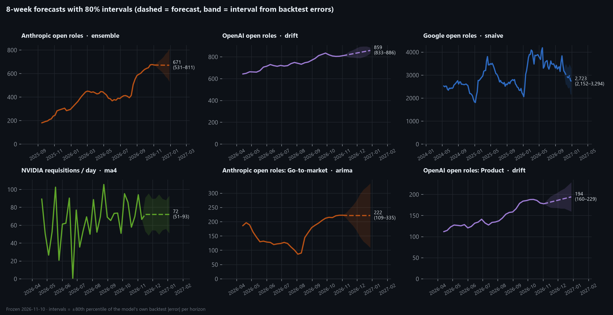
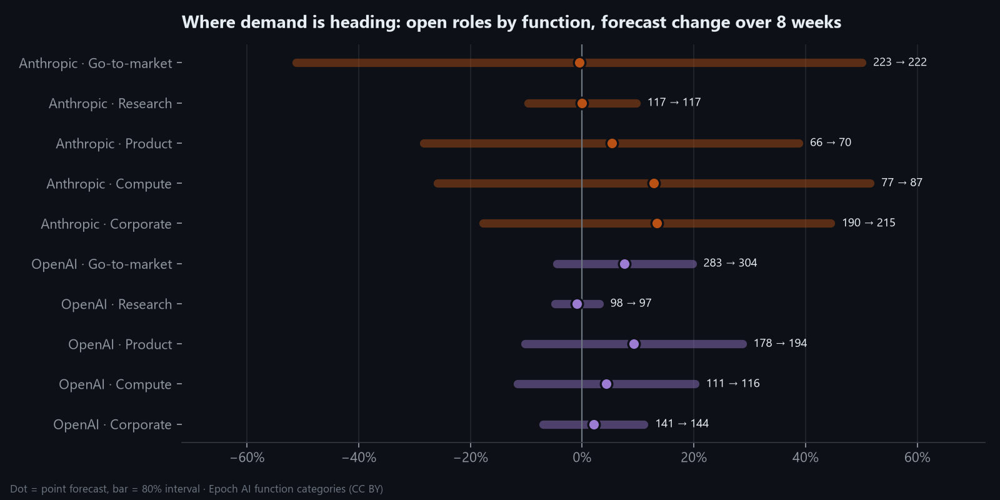
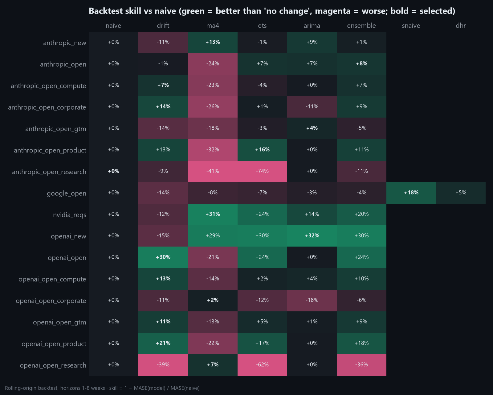

# Sprint 7 — Demand Forecasting

**Week of:** 2026-12-21 (done early, 2026-11-10) · **CadetX task 7** · **Status:** ✅ Done (forecasts frozen; prospective scoring runs weekly)

## Goal

Forecast near-term hiring demand from the time-series signals, with one shared horizon so the companies
compare consistently, and do it honestly: proper backtests, calibrated intervals, and forecasts frozen in
advance so they can be scored against what actually happens.

## CadetX deliverables

- [x] Forecasting outputs & visual plots: [`data/forecasts/`](../../data/forecasts/) · [generated summary](../../reports/forecast/summary.md)
- [x] A brief explanation of the chosen models and why: [Model choice](#model-choice-and-why) below

## What is forecast

**Shared horizon: 8 weeks**, weekly series (Monday-start weeks), 16 series in total:

| Series | Companies | History | Source |
|---|---|---|---|
| Open roles (stock) | 🟠 🟣 🔵 | Anthropic 130 wks (2024–26) · OpenAI 34 wks · **Google 176 wks (2023–26)** | Internet Archive + Epoch |
| Open roles by **function** (GTM, research, product, compute, corporate) | 🟠 🟣 | 34 wks each | Epoch categories |
| New postings / week (flow) | 🟠 🟣 | 33 wks | Sprint 5 flows |
| Requisitions created / day | 🟢 | 30 wks | Requisition-ID estimator |

Code: [`series.py`](../../src/forecast/series.py) · [`models.py`](../../src/forecast/models.py) ·
[`run_forecast.py`](../../src/forecast/run_forecast.py) · [`score_frozen.py`](../../src/forecast/score_frozen.py) ·
[`report.py`](../../src/forecast/report.py)

## Method

1. **Candidate models.**
   - Baselines: naive (no change), drift (recent trend), 4-week moving average.
   - Statistical: damped-trend ETS, ARIMA (order chosen by AIC on the *early* half only, to avoid look-ahead).
   - Seasonal, for Google's 3+ years: seasonal naive and dynamic harmonic regression (ARIMA + yearly Fourier terms).
   - A median **ensemble**.
2. **Rolling-origin backtest.** Train up to a week, forecast 1–8 weeks ahead, step forward, repeat (every week
   from week 16 for short series; the last 52 weeks for long ones): 12,200 scored forecasts across all models.
3. **Metric: skill vs naive** = 1 − MASE(model) / MASE(naive) at the same horizons. 0% means no better than
   "nothing changes", which is a hard baseline for hiring stock.
4. **Selection:** lowest backtest MASE per series.
5. **80% intervals: empirical.** The forecast ± the 80th percentile of that model's own absolute backtest
   error at each horizon. They come from how wrong the model has actually been, not from textbook assumptions.
6. **Freeze:** [`data/forecasts/frozen/2026-11-10.csv`](../../data/forecasts/frozen/2026-11-10.csv) (128
   targets) is committed and never edited. [`score_frozen.py`](../../src/forecast/score_frozen.py) scores it
   against actuals each week. Live [scorecard](../../reports/forecast/scorecard.md).

## Results

| Series | Model | Skill vs naive | Now | In 8 weeks (80% interval) |
|---|---|---:|---:|---|
| 🟠 Anthropic open roles | ensemble | +8% | 673 | 671 (531–811) |
| 🟣 OpenAI open roles | drift | **+30%** | 811 | 859 (833–886) |
| 🔵 Google open roles | seasonal naive | **+18%** | 3,182 | 2,723 (2,152–3,294): December dip |
| 🟢 NVIDIA requisitions / day | 4-wk average | **+31%** | 67 | 72 (51–93) |
| 🟣 OpenAI new postings / wk | ARIMA | **+32%** | 64 | 53 (39–67) |
| 🟠 Anthropic new postings / wk | 4-wk average | +13% | 56 | 49 (21–77) |

Full table (all 16 series) in the [summary](../../reports/forecast/summary.md#all-series-8-week-horizon).

### Where demand is heading (by function)

- 🟣 **OpenAI keeps growing across functions**: product +9%, GTM +8%, compute +4% over 8 weeks, with tight-ish
  intervals because its growth has been steady.
- 🟠 **Anthropic: corporate (+13%) and compute (+13%) keep growing; GTM levels off** (223 → 222) after its
  August–October surge. Anthropic's intervals are wide: its hiring changes in bursts, and the models say so.
- 🔵 **Google: the seasonal pattern dominates.** Expect the usual end-of-year dip (to ~2,700) before the
  January–March rebound seen in each of the last three years.

## Model choice and why

- **Growing stocks** (OpenAI open roles, product, GTM, compute; Anthropic corporate and compute): **drift / ETS**
  win (+7% to +30%). Their trends have been persistent, so extrapolating the recent slope beats standing still.
- **Google**: **seasonal naive** wins (+18%). The yearly hiring cycle carries real predictive information, and
  the harmonic-regression model also beats naive (+5%), though less.
- **Noisy flows** (new postings, NVIDIA requisitions): **moving averages / ARIMA** win (+13% to +32%). These
  hover around a level, and smoothing the noise is what helps.
- **Volatile or flat series** (Anthropic research and GTM, OpenAI corporate and research): nothing beats naive by
  much. Anthropic's August regime change is unforecastable from its own history. That's exactly where *leading
  indicators* (Sprint 9) are needed.

## Honest caveats

- **Growth gets under-forecast.** Backtest bias is positive for most growing series (e.g. Anthropic +50 roles at 8
  weeks): during expansions, actuals outran every model. Intervals are symmetric, so this is reported, not hidden.
- **Selection bias.** Choosing the best model on the backtest flatters its backtest score. The frozen-forecast
  scorecard is the unbiased test.
- **Short histories.** 34 weeks for OpenAI and the function series; one regime each. Google's 3-year history is the
  only one long enough for seasonality.
- **Archive gaps** are linearly interpolated (19 weeks for Anthropic, 26 for Google; flagged in the data).
- **NVIDIA's estimator** is an activity index (all requisitions), not posted jobs.

## Weekly routine addition

After each data refresh (Monday):
`python -m src.collect.epoch_history` → `python -m src.forecast.score_frozen`. The Internet Archive refresh
(`python -m src.collect.wayback_history`) is monthly. Snapshot runs record Google's and NVIDIA's board totals,
which feed the actuals.

---

[← Back to README](../../README.md)
