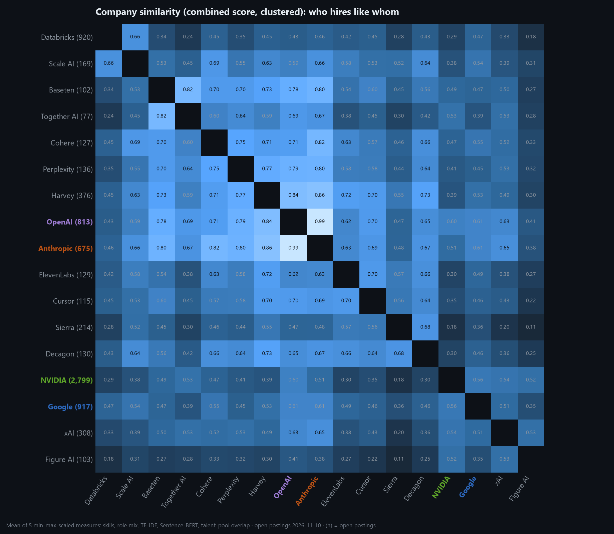
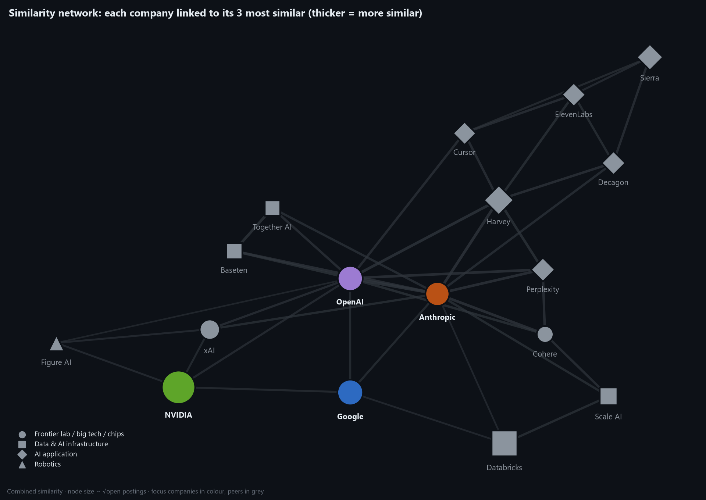
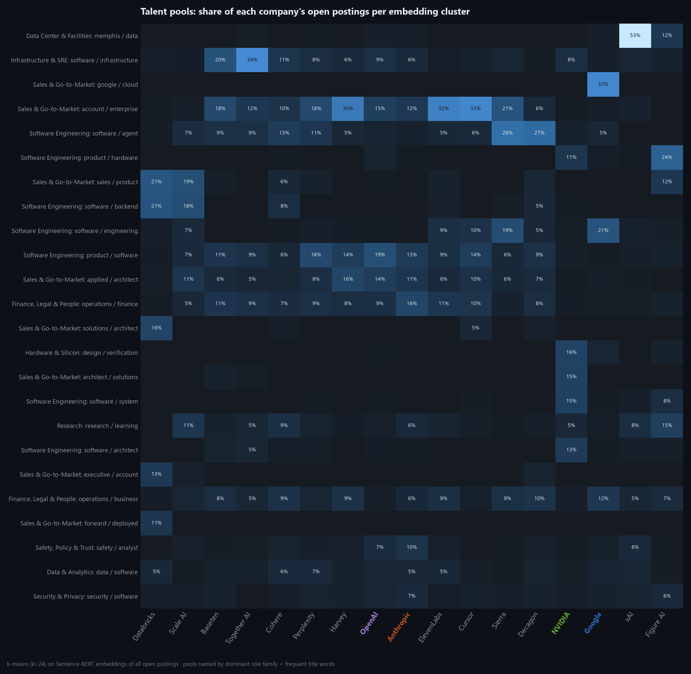

# Sprint 8 — Company Similarity Scoring

**Week of:** 2026-12-28 (done early, 2026-11-10) · **CadetX task 8** · **Status:** ✅ Done

## Goal

Measure how similar the companies are, using skills, tech stack, role categories and text, within one
shared framework, and explain what drives the similarities and differences.

## CadetX deliverables

- [x] Similarity tables & visuals (heatmaps / network graphs): [`data/similarity/`](../../data/similarity/) · [generated summary](../../reports/similarity/summary.md)
- [x] A short explanation of what drives the similarities and differences: [Findings](#findings) below

## From 4 companies to a market map

Similarity between four companies is a 6-cell table. To make it meaningful, Sprint 8 adds **13 AI-market peers**,
collected through the **same documented public ATS APIs** as Anthropic and OpenAI (one request each; their
websites are never contacted; board identity verified; review in the
[Sprint 1 doc](sprint-01-data-sources-legal.md#peers-added-in-sprint-8-approved) and source register):

| Segment | Companies | Open postings |
|---|---|---:|
| Frontier labs | 🟠 Anthropic, 🟣 OpenAI, xAI, Cohere | 675 · 813 · 308 · 127 |
| Big tech / chips | 🔵 Google (sample), 🟢 NVIDIA | 917 · 2,799 |
| Data & AI infrastructure | Databricks, Scale AI, Together AI, Baseten | 920 · 169 · 77 · 102 |
| AI applications | Harvey, Sierra, Perplexity, Decagon, ElevenLabs, Cursor | 376 · 214 · 136 · 130 · 129 · 115 |
| Robotics | Figure AI | 103 |

That's 17 companies and **11,223 postings** in the corpus. Peers run through the identical Sprint 3–4 pipeline and
are included in every weekly snapshot from now on (`run_snapshot peers`).

## Five similarity measures

Population: postings open on 2026-11-10. Content measures use technical roles (like-for-like); structure measures
use all roles. Code: [`build_similarity.py`](../../src/similarity/build_similarity.py).

| Measure | What it captures | How |
|---|---|---|
| **Skills** | Same technologies & methods | Cosine of skill-share vectors (211-skill taxonomy) |
| **Role mix** | Same organisation shape | 1 − Jensen–Shannon distance of role-family distributions |
| **TF-IDF** | Same vocabulary | Cosine of TF-IDF (1–2-gram) centroids of lemmatised text |
| **Embeddings** | Same *meaning* | Cosine of **Sentence-BERT** (`all-MiniLM-L6-v2`) centroids |
| **Talent pools** | Compete for the same people | k-means (k = 24) over embeddings of *all* postings → each company's share per pool → histogram overlap |
| **Combined** | Overall | Mean of the five after min–max scaling each across pairs |

The measures **agree moderately** (Spearman across pairs): skills ↔ embeddings 0.71, embeddings ↔ talent pools 0.68,
but role mix ↔ TF-IDF only 0.13. They see different things (organisation shape vs. content), which is why the
combined score averages them rather than trusting any single one.

## Findings

**1. 🟠 Anthropic and 🟣 OpenAI are near-twins (0.99), the most similar pair in the market.**
They share the same skills (Python, AI agents, ML, LLMs), the same "fast-paced" culture, and the same mix of
GTM, finance and research roles. The differences are in emphasis: Anthropic leans to ML/LLM research and RL,
OpenAI to APIs, observability and product engineering (consistent with Sprint 6).

**2. An "LLM + go-to-market" bloc forms around the two labs.** Their nearest peers are AI *applications* that
sell LLM products to enterprises: **Harvey (0.86 to Anthropic), Perplexity, Cohere, Baseten**. The labs now hire
more like enterprise-AI vendors than like research institutes.

**3. 🟢 NVIDIA and 🔵 Google sit apart.** NVIDIA's nearest neighbour is OpenAI at only 0.60; it shares Python and
networking with everyone but owns GPU, C++ and chip design. Google (0.61 to both labs) is a hybrid of lab-style ML
hiring and big-company engineering (Java, C++, Google Cloud). A **"physical AI" corner** links NVIDIA, xAI and Figure
AI (robotics, hardware, data centers).

**4. Natural pairs among peers:** Baseten ↔ Together AI (0.82, inference infrastructure), Sierra ↔ Decagon (0.68,
customer-service agents), Databricks ↔ Scale AI (0.66, data platforms).

### Talent pools: who competes for the same people

The embedding clusters show where hiring overlaps, which is the practical "competitor demand" view:

- **Enterprise account executives** are the most contested pool. They make up 30–33% of postings at Harvey,
  ElevenLabs and Cursor, and 12–15% at the labs. AI companies are competing hard for the same sales talent.
- **Product-software engineers** are shared broadly (OpenAI 19%, Perplexity 18%, Cursor 14%, Anthropic 13%).
- **Agent engineering** is concentrated at the AI-application companies (Sierra 28%, Decagon 27%).
- **Inference/infra engineers:** Together AI 34%, Baseten 20%, Cohere 11%.
- **Distinct pools:** NVIDIA's chip-design/verification and solutions-architect pools, Google's Cloud sales pool,
  Databricks' field/solutions pools, and, strikingly, **53% of xAI's open postings** in a *data-center &
  facilities (Memphis)* pool: xAI's hiring is dominated by its data-center build-out.
- **Safety, policy & trust** is a pool almost only the labs draw from (Anthropic 10%, OpenAI 7%, xAI 6%).

Each posting's pool is stored as `role_cluster_id` in [`role_clusters.csv`](../../data/similarity/role_clusters.csv)
(the brief's field).

## Outputs

| File | Content |
|---|---|
| `similarity_combined.csv`, `similarity_{skills,role_mix,tfidf,embedding,talent}.csv` | 17 × 17 matrices |
| `pairs.csv` | Every pair with all five measures + combined |
| `talent_pool_shares.csv` | Each company's share per talent pool |
| `role_clusters.csv` | Pool assignment per posting |
| `embeddings.parquet` | Sentence-BERT vectors (local cache, gitignored, regenerable) |

## Limitations

- **Snapshot, not trend:** similarity is measured on open postings today; peers have no history yet.
- **Sample effects:** Google is a sample, and small boards (Together AI, 77) give noisier profiles. Companies with
  fewer than 15 technical postings would be excluded (none were).
- **Cluster names are automatic** (dominant role family + frequent title words), so treat them as labels, not
  definitions.
- **Combined score is relative:** min–max scaling makes it a ranking within this set of 17, not an absolute
  measure.

Run: `python -m src.similarity.build_similarity` (first run embeds about 8k postings, ~5 min on CPU; later runs use the cache).

---

[← Back to README](../../README.md)
