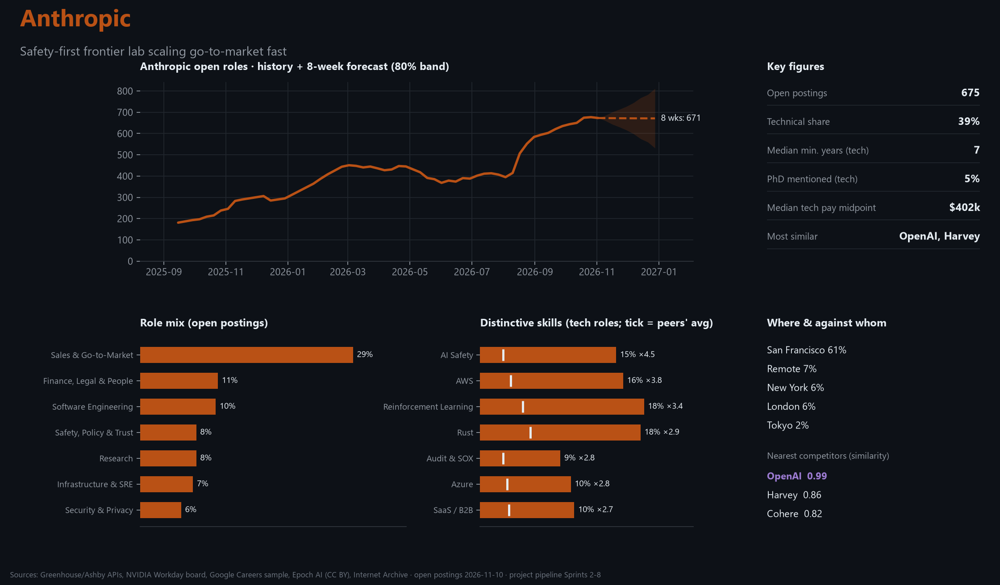
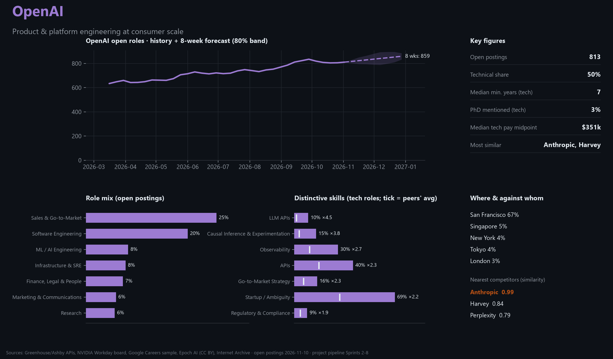
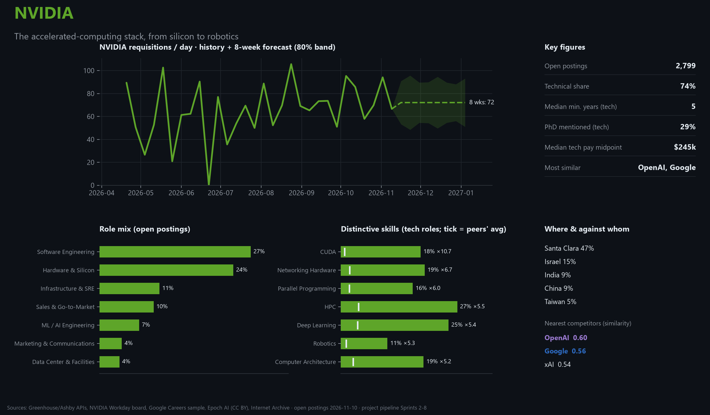
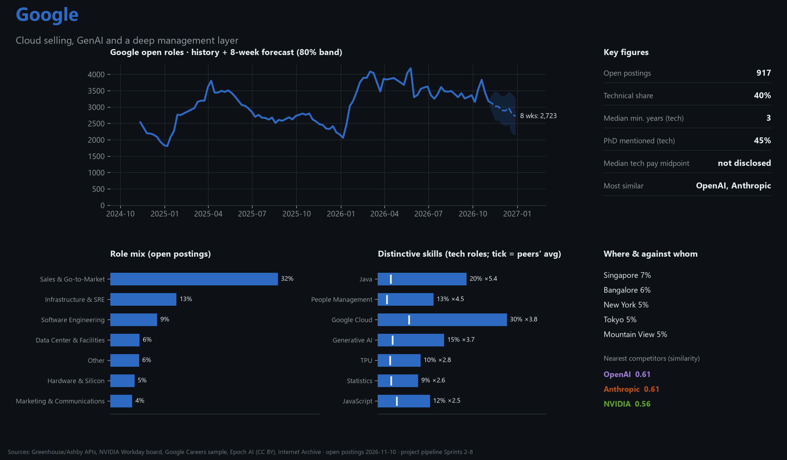
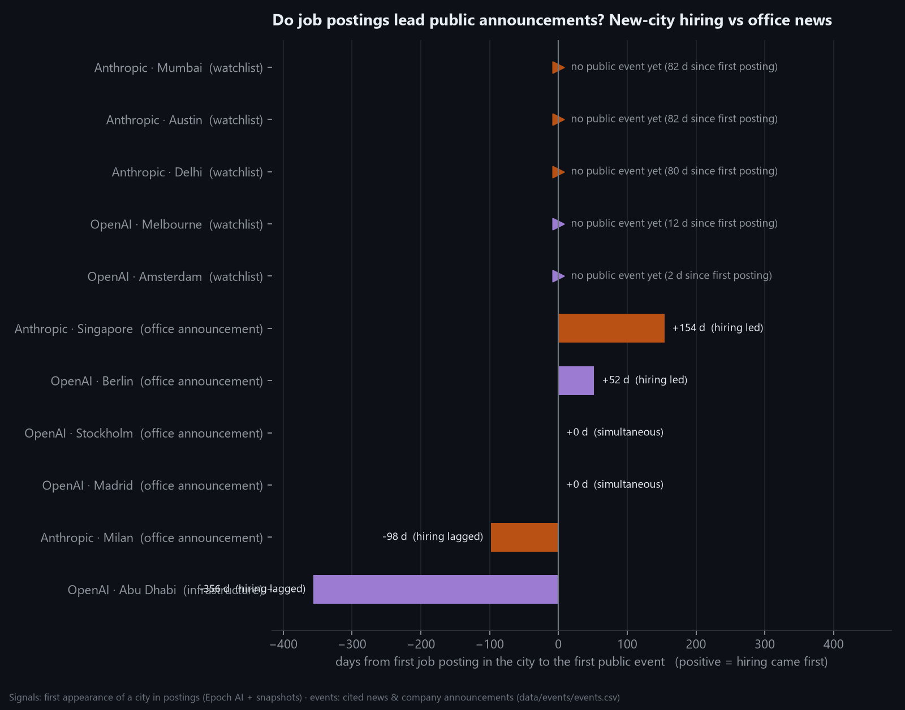
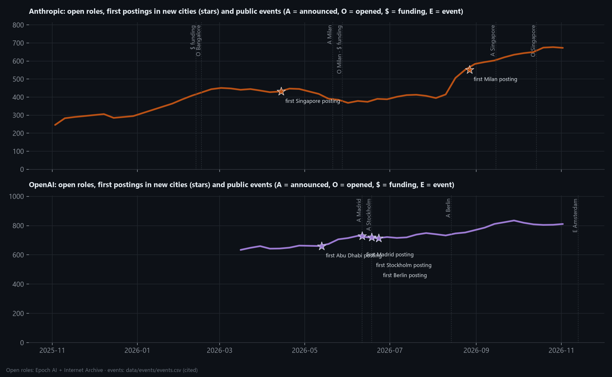

# Sprint 9 — Insight Generation & Reporting

**Week of:** 2027-01-04 (done early, 2026-11-10) · **CadetX task 9** · **Status:** ✅ Done

## Goal

Turn the analysis, comparisons and forecasts into clear, actionable insights, using one reporting structure
for every company, and test the project's central claim: **do job postings lead what companies do?**

## CadetX deliverables

- [x] A concise insight report & visual summaries: **[Hiring Intelligence Report](../../reports/insights/insight_report.md)** + one-page company cards
- [x] A short explanation of each company's hiring strategy & position: [report §2](../../reports/insights/insight_report.md#2-company-profiles)

## Shared reporting structure

Every company profile answers the same five questions, in the same order:

| Section | Question | Evidence from |
|---|---|---|
| Position | Where does it sit in the market? | Similarity (Sprint 8) |
| Hiring strategy | What is it building, and how fast? | Trends + comparison (Sprints 5–6) |
| Signals | What changed recently, and what's new? | Expansion, emerging terms (Sprint 5), events (this sprint) |
| 8-week outlook | What happens next? | Forecasts (Sprint 7) |
| So what | What should each audience do? | Synthesis |

The **company cards** ([`company_cards.py`](../../src/insights/company_cards.py)) put the same structure on one
page per company, generated from the pipeline outputs, so they refresh with each run:

| | |
|---|---|
|  |  |
|  |  |

## Leading-indicator test

The review flagged that the project *asserted* job postings are a leading indicator without testing it. Sprint 9
tests it.

1. **Event dataset:** [`data/events/events.csv`](../../data/events/events.csv). 13 public events (office
   announcements and openings, funding rounds, infrastructure, executive events) from news and company
   announcements, **each with a source URL**, researched 2026-11-10. Dates with only month precision are flagged.
2. **Matching:** each Sprint 5 expansion signal (a city's first appearance in a company's postings) is matched to the
   first *presence* event (office announcement/opening or infrastructure) for the same company and city.
   `lead_days = event − signal`. [`leading_indicators.py`](../../src/insights/leading_indicators.py)
3. **Funding response:** Anthropic's open roles 13 and 26 weeks after each round.

| Result | Cases |
|---|---|
| Hiring **led** the announcement | 🟠 Anthropic Singapore (+154 days), 🟣 OpenAI Berlin (+52 days) |
| **Simultaneous** | 🟣 OpenAI Madrid, Stockholm (postings went live with the announcement) |
| Hiring **lagged** | 🟠 Anthropic Milan (−98 days), 🟣 OpenAI Abu Dhabi (−356 days after Stargate UAE) |
| Funding → hiring | Series G: −8 roles in 13 weeks; **Series H: +184 in 13 weeks, +305 in 26 weeks** |
| **Watchlist** (no public event yet) | Anthropic Mumbai, Delhi, Austin; OpenAI Melbourne, Amsterdam |

**Verdict:** a useful but not infallible leading indicator, strongest when companies staff up before announcing.
The watchlist and the frozen forecasts are live, falsifiable predictions, to be re-checked at the final presentation.

## Outputs

| File | Content |
|---|---|
| [`reports/insights/insight_report.md`](../../reports/insights/insight_report.md) | The report (executive summary, market picture, 4 profiles, leading-indicator test, actions by audience, limitations) |
| `reports/insights/figures/card_*.png` | Company cards |
| `reports/insights/figures/lead_lag.png`, `timeline.png` | Leading-indicator visuals |
| `data/events/events.csv` | Cited event dataset |
| `data/insights/lead_lag.csv`, `watchlist.csv`, `funding_response.csv` | Analysis tables |

## Limitations

- **Six lead-lag cases** are case studies, not a statistical test; event coverage depends on what news reported
  (absence of news ≠ absence of an office).
- Funding effects are confounded by everything else happening at the same time (product launches, market demand).
- Some secondary news sources conflict on dates; where they did, the earliest well-sourced date was used and the
  disagreement noted in `events.csv`.

---

[← Back to README](../../README.md)
