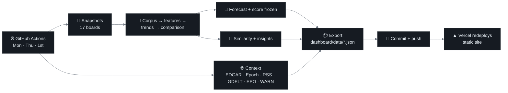

# Sprint 10 — Automated Pipeline & Intelligence Console (optional task)

**Week of:** 2027-01-11 (done early, 2026-11-10) · **CadetX optional task** · **Status:** ✅ Done

## Goal

Connect collection → preprocessing → skills → trends → forecast into one scheduled pipeline, and put its output
somewhere people will actually look: a live, public dashboard that refreshes itself.

## CadetX deliverables

- [x] Documented pipeline design & automation steps (this page)
- [x] Final workflow in GitHub: [`.github/workflows/refresh.yml`](../../.github/workflows/refresh.yml)
- [x] Extra: **SIGNALS**, a static AI hiring-intelligence console in [`dashboard/`](../../dashboard/) served by Vercel
- [x] Extra: context data beyond job postings (SEC filings, model releases, newsroom feeds, layoffs, patents)

## Pipeline design

| Schedule (UTC) | Mode | What runs |
|---|---|---|
| Monday 06:00 | `full` | All 17 boards + Epoch AI history, then the full rebuild |
| Thursday 06:00 | `light` | NVIDIA + Google only (the fastest-moving boards), then the full rebuild |
| 1st of month 07:00 | `wayback` | Internet Archive open-role counts, then the full rebuild |
| Manual | `full` / `light` | `workflow_dispatch` from the Actions tab |

**Robustness rules**

- Collection and external sources are **non-fatal**: a throttled board (Google Careers may limit GitHub's IP ranges)
  logs a warning and the rebuild continues from the data that exists. The snapshot guards from Sprint 2 (5%/95%
  size checks) still keep broken snapshots out of the data.
- Scheduled runs set `FREEZE_FORECAST=0`: they refresh `latest_forecast.csv` and **score** the frozen forecast, but
  never freeze a new one, so the public scorecard keeps tracking `data/forecasts/frozen/2026-11-10.csv`.
- Only changed files are committed (`github-actions[bot]`); the job is serialised (`concurrency: refresh`) so two
  runs never race on a push.
- Secrets live in repository secrets (`SEC_CONTACT_EMAIL`, `EPO_OPS_KEY`, `EPO_OPS_SECRET`) and in a gitignored
  `.env` locally. No secret is ever written to code or data.

## New data sources (beyond job postings)

Job postings show momentum, priorities and expansion, but not revenue, launches or layoffs. These sources supply
that context. Each one has a row in the [source register](../source-register.csv).

| Source | What it adds | Access | Status |
|---|---|---|---|
| **SEC EDGAR XBRL** (companyfacts API) | Quarterly revenue, R&D, net income, capex for NVIDIA and Alphabet | Free, official; contact email in User-Agent as SEC requires | ✅ 2021 → Q3 2026 |
| **Epoch AI Notable AI Models** | Release dates of frontier models per lab | Free CSV, CC BY | ✅ 207 releases since 2022 |
| **Company newsroom RSS** (OpenAI, Google, NVIDIA) | Official announcements, topic-tagged | Public feeds | ✅ 237 headlines (Anthropic has no feed) |
| **GDELT DOC 2.0** | Worldwide press coverage incl. Anthropic | Free API, ≤ 1 request / 5 s | ⏳ rate-limited from the dev IP; fills on scheduled runs |
| **EPO Open Patent Services** | Patent publications per applicant per quarter + latest titles | Free account (key + secret) | ✅ 2023 → now (OpenAI +127%, NVIDIA +72%, Google −19% over the last 4 quarters) |
| **California WARN report** | Layoff notices (employer, date, headcount) | Official public spreadsheet | ✅ 0 matches for tracked companies (genuine) |

Only headlines, dates, sources and links are stored for news, never article text. USPTO PatentsView was dropped:
it was retired on 2026-03-20 and its successor needs US identity verification, so EPO OPS (which also covers US
filings) is used instead.

**Example finding:** Alphabet's Q2 2026 10-Q reports net income of **$112.2B** on lower revenue. The filing shows
$98.0B of non-operating gains (equity-security marks), so the figure is real, not a parsing error. The dashboard
plots revenue and R&D instead of net income for exactly this reason.

## Dashboard: SIGNALS

**Live:** [signals-hiring.vercel.app](https://signals-hiring.vercel.app)

**Name and identity.** The console is called **SIGNALS**. The wordmark is the word set normally in Inter ExtraBold
with a gradient copy laid exactly on top, cropped to the A and the upright of the L, so it reads SIGNALS first and
"AI" second. The crop edge is measured from the font at runtime, so it holds at any size. The gradient uses the four
company colours and flows slowly (static for reduced-motion users). Favicon: the gradient "AI" drawn as shapes.
Social preview, touch icon and README banner are rendered from `assets/brand/render.html`.

A "sleek intelligence console": a minimal dark UI with a few OSINT touches (timestamped signal feed, source and
confidence labels, "updated · next refresh" status). No server, no database: the page reads eight small JSON files
(< 40 KB each) written by `src.dashboard.export`.

| Section | What it shows | Data |
|---|---|---|
| Hero | 3D globe (globe.gl): hub points per company, arcs HQ → new cities, pulsing rings on unannounced cities; live counters; ranked expansion list next to it | `globe.json`, `meta.json` |
| Signal feed | New cities, watchlist, function surges, emerging terms, model releases, filings, newsroom items; filter by company and type | `signals.json`, `news.json` |
| Pulse | KPI card per company + open roles with forecast and 80% band, 6M / 1Y / All | `companies.json` |
| Company deep-dive | Trajectory with model releases, role mix, functions over time, **hiring vs SEC financials**, distinctive skills, hubs, nearest peers | `companies.json`, `context.json` |
| Prediction tracker | Frozen forecasts vs actuals, lead-lag of hiring vs news, watchlist, funding → hiring | `tracker.json` |
| Market map | 17-company force graph + talent-pool heatmap | `market.json` |

- **Stack:** plain HTML/CSS/JS, ECharts 6.1.0 and globe.gl 2.46.2 from jsDelivr (pinned). Same tokens and company
  colours as `src/style.py`. Logos are Simple Icons (CC0), drawn with CSS masks in each company's colour.
- **Responsive:** checked at 1024 px and 375 px (no horizontal scroll; tables scroll inside their panel; the globe
  stops capturing touch on phones so the page still scrolls).
- **Hosting:** [`vercel.json`](../../vercel.json) serves `dashboard/` as a static site; every data commit redeploys it.
- **Local preview:** `python -m http.server 8765 --directory dashboard`.

## Story layer: from signals to explanations

The first version showed *what* changed but left the reader to work out *why it matters*. The story layer
(`src/insights/story.py` → `dashboard/data/story.json`) adds a briefing and one chapter per company at the top of the
page, each with a headline, a short story, counters, "watch next", evidence cards and new-city readings.

**1. Evidence engine (deterministic rules).** Interpretation rules read the titles and departments of open postings:

| Theme | Example titles that trigger it | Reading |
|---|---|---|
| Building its own data centers | Data Center Capacity Delivery Manager, White Space Manager, Power Generation Engineer | Own compute sites instead of only renting cloud |
| Selling to government and defense | Account Executive, Federal Civilian Sales; Public Sector; clearance roles | Government contracts needing cleared staff |
| Deploying inside large enterprises | Forward Deployed / Applied AI Engineer, Solutions Architect | Roll-outs inside customers, not only self-serve |
| Designing its own chips | TPU / silicon / design verification | Less dependence on GPU suppliers |
| Robotics, devices, networking, autonomous driving, ads, safety, sales | … | see `THEMES` |

Each claim carries the signal (open roles, **growth** 13 weeks vs the 13 before where dated history exists, **lift**
vs the other focus companies), the **place** (cities from job locations), example postings, corroborating headlines
or events (→ `confirmed`), and a confidence label. Themes that are a company's core business are skipped for it
(data centers and chips for NVIDIA). New cities are classified by the roles posted there (sales office, engineering
hub, regional hub, data-center site). Examples from the first run: Anthropic's government roles 6 → 25 and
data-center delivery roles 8 → 26 per 13 weeks, with **Austin**'s first posting a data-center role; Google's chip
design concentrated in **Tel Aviv and Haifa** (3.4× peers); OpenAI's ads/shopping roles at 13× peers, matching
its ChatGPT Ads announcements.

**2. Narrator (free open model).** `src/llm.py` calls **Groq** (`openai/gpt-oss-120b`, free tier: 1,000 requests/day,
8k tokens/min; about 5 calls per refresh), with OpenRouter's free tier as fallback and template text as the final
fallback. The model sees only the evidence plus a glossary (lift is not growth; lift below 1.3 is "about the same").
Before anything is published, every number in its text must match a number in the evidence (rounding tolerated),
and multiples written as words ("doubled", "four-fold") must match a growth ratio; otherwise it gets one retry and
then the template is used. Briefing bullets always come straight from the evidence. Each chapter states who wrote it.

**Known limit:** the check is per company: it proves a number exists in that company's evidence, not that it is
attached to the right claim. Evidence cards therefore always show the raw numbers next to the prose.

## Tests

`tests/test_sprint10.py` (13 tests) and `tests/test_story.py` (25 tests: theme rules incl. false positives such as "Fraud Defense", the number check, LLM fallback, story.json contract); 102 in total.: quarterly XBRL values incl. the year-to-date differencing guard,
news topic tagging, the news ↔ watchlist matcher, JSON-safe export, and the JSON contract the page relies on (keys,
shapes, intervals contain the point, valid statuses, file sizes).

The matcher test caught a real bug: the office-wording pattern `opens?` also matched inside "**Open**AI", so any
OpenAI headline naming a watchlist city would have counted as a confirmation. Fixed with word boundaries.

## Limits

- Postings are not hires; financials exist only for public companies (NVIDIA, Alphabet). Private-lab revenue is
  never shown as a figure.
- GDELT data will appear only after scheduled runs. The page states this instead of hiding it.
- EPO's search quota is small, so finished quarters are cached in `patents_quarterly.csv` and only the last two are re-queried.
- Google Careers may throttle GitHub runners; Thursday's light run is the canary. If it fails repeatedly, run the
  Google snapshot locally and push.
- The globe is for orientation, not comparison; the ranked list and charts carry the numbers.

## Setup left to the owner

1. Repository secrets: `SEC_CONTACT_EMAIL`, `EPO_OPS_KEY`, `EPO_OPS_SECRET`, `GROQ_API_KEY` (done), optional `OPENROUTER_API_KEY`.
2. Vercel: connected; live at [signals-hiring.vercel.app](https://signals-hiring.vercel.app).

---

[← Back to README](../../README.md)
