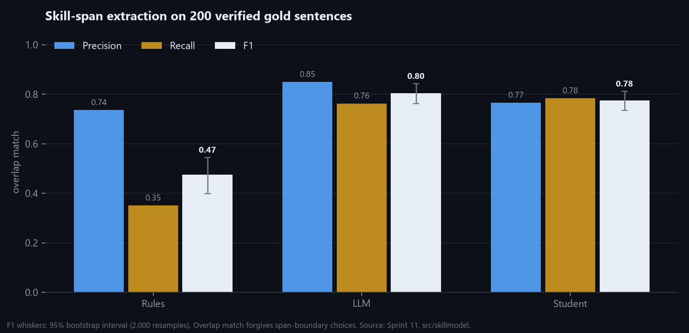

# Sprint 11 — Fine-Tune a Skill Extraction Model (optional task)

**Week of:** 2027-01-18 (done early, 2026-11-10) · **CadetX optional task** · **Status:** ✅ Done (v1; v2 retrain
once the remaining LLM labels are collected)

## Goal

Fine-tune a pre-trained model to extract skills more accurately than the rule-based baseline, and compare it with
a large language model used directly.

## CadetX deliverables

- [x] Fine-tuned model & evaluation metrics: [results summary](../../reports/skillmodel/summary.md)
- [x] Short note on training process & gains (this page)

## Headline results

On 200 held-out sentences (422 skill spans) verified by the project owner. Overlap match counts a predicted span
as correct if it overlaps a gold span, so it forgives boundary choices such as "Python" vs "Python programming".

| System | Precision | Recall | F1 (95% CI) | Exact-match F1 |
|---|---:|---:|---:|---:|
| Rules (Sprint 4, 211-skill taxonomy) | 0.74 | 0.35 | 0.47 (0.40–0.54) | 0.32 |
| LLM, zero-shot (Groq `gpt-oss-120b`, free tier) | 0.85 | 0.76 | **0.80** (0.76–0.84) | 0.72 |
| **Fine-tuned student** (RoBERTa-base on LLM labels) | 0.77 | 0.78 | **0.78** (0.73–0.81) | 0.64 |

- **Student vs rules: +0.30 F1** (95% CI +0.24 to +0.37). Recall more than doubles (0.35 → 0.78) at similar
  precision. The rules were precise but found only about a third of the skills.
- **Student vs its LLM teacher: −0.03** (−0.06 to 0.00), statistically about level, after 1,132 training sentences
  and 77 seconds of training.
- **Speed and cost:** the student tags about **1,060 sentences per second** on a laptop GPU, for free, every week.
  The free LLM tier stopped after 1,257 sentences a day. That is the case for distillation: LLM quality at
  pipeline scale.
- **Robustness:** removing the 19 owner-added spans that the guidelines exclude ("strict" gold) changes no F1 by more
  than 0.01 and no ranking.

## How it was built

1. **Data** (`src/skillmodel/data.py`): 127,847 unique sentences from the requirements, preferred and
   responsibilities sections. Postings were split 90/10 by a hash of `job_id`, so no posting is in both training and
   the test set. Gold: 200 sentences, 40 each from Anthropic, OpenAI, NVIDIA, Google and the peers, across 15 role
   families, at most one per posting. Training pool: 3,000 sentences.
2. **Guidelines** ([`docs/skill-labelling-guidelines.md`](../skill-labelling-guidelines.md)): a skill is a tool,
   method, domain or certification the candidate needs or uses; teams, customers, products-as-context, traits,
   years and degrees are not.
3. **Gold set:** pre-labelled by the assistant (372 spans) from the rule and LLM suggestions reviewed against the
   guidelines, then verified sentence by sentence by the owner on a local page (`src/skillmodel/annotate.py`).
   The owner added 50 spans and removed none (422 in total).
4. **Teacher labels** (`src/skillmodel/llm_label.py`): Groq's free `gpt-oss-120b` labels training sentences in
   batches of 10, with the guidelines as instructions. Spans are mapped back to exact character offsets.
   Resumable: 1,257 of 3,000 sentences so far (the free daily limit).
5. **Student** (`src/skillmodel/train.py`): token classification with BIO tags, AdamW (lr 3e-5), 8 epochs, best
   epoch chosen on a 10% dev split of the *training* labels (the gold set is never used for choices), fp16 on an
   RTX 4050 (6 GB). Predicted spans are snapped to whole words.
6. **Evaluation** (`src/skillmodel/evaluate.py`, `report.py`): exact and overlap span P/R/F1, 2,000 paired
   bootstrap resamples for intervals and differences.

### What was tried

| Variant | Training labels | Sentences | F1 | Reading |
|---|---|---:|---:|---|
| RoBERTa-base | rules | 2,700 | 0.49 | Learns the taxonomy and little more: rule labels teach "which words", not "what a skill is" |
| **RoBERTa-base** | **LLM** | **1,132** | **0.78** | Best: LLM labels teach the concept |
| RoBERTa-base | LLM ∪ rules | 1,132 | 0.76 | Highest recall (0.81), but rule spans cost precision |
| DeBERTa-v3-base | LLM | 1,132 | 0.77 | Same level: the base model is not the bottleneck |
| JobBERT (job-posting pre-training) | LLM | 1,132 | 0.76 | Domain pre-training did not help here |

All base models land within 0.02 of each other, so **the amount of LLM-labelled data is the limiting factor**, not
the architecture.

## Error analysis (best student)

- **Boundaries inherited from the teacher:** the student adds head nouns ("contract governance *controls*",
  "machine learning *principles*") where the guidelines want the shortest name. This is most of the gap between
  overlap F1 (0.78) and exact F1 (0.64). It was not patched with gold-tuned clean-up rules, which would overfit the
  test set.
- **Over-labelling:** product features and context words ("templates", "approval routing", "Gemini Nano").
- **Misses:** short or rare domain terms ("DFM", "Timing closure", "diffusion") and the owner's broader spans
  (teams, degrees).
- **Bug found and fixed:** sub-word tags first produced fragments ("Pear" from "Pearson"); spans now snap to whole
  words, which is covered by a test.

## Using it: skills the taxonomy is missing

Run over 5,000 unseen sentences, the student finds frequent skill spans that **no taxonomy rule matches**:
automation, compliance, debugging, troubleshooting, privacy, virtualization, capacity planning, billing, pricing,
solutions architecture, playbooks, simulation… ([full list](../../reports/skillmodel/new_skill_candidates.csv)).
These are candidates for the Sprint 4 taxonomy, after a human check (the list still contains generic words).

## Limits and honest caveats

- **One annotator plus the assistant.** The gold set was pre-labelled by the assistant and verified by one person;
  no inter-annotator agreement could be measured.
- **Possible bias toward the LLM:** the pre-labels started from rule and LLM suggestions. The overlap metric and the
  owner's 50 additions reduce, but cannot remove, this bias.
- **200 sentences** give intervals of about ±0.04 F1. Differences smaller than that are not conclusions.
- **The student is not yet in the weekly pipeline.** The dashboard still uses the rules, which stay the auditable
  baseline. Model weights are not committed (`models/` is gitignored) and are rebuilt by `src.skillmodel.train`.

## Next

1. Finish the remaining ~1,750 LLM labels (`python -m src.skillmodel.llm_label data/skillmodel/train_pool.jsonl`, one
   more free-tier day) and retrain: the data-size finding suggests this is the cheapest gain.
2. Add the reviewed new-skill candidates to the taxonomy.

Run: `python -m src.skillmodel.data` → `llm_label` → `annotate` → `train --labels llm` → `report`.

---

[← Back to README](../../README.md)
