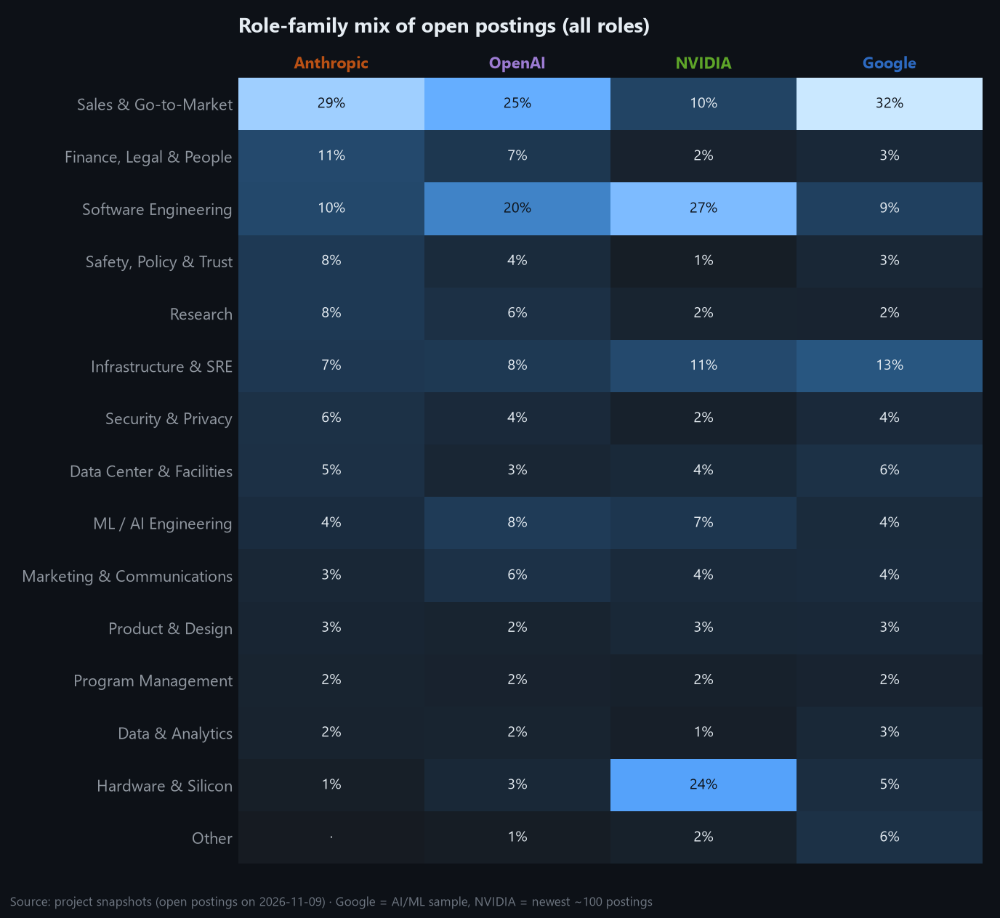
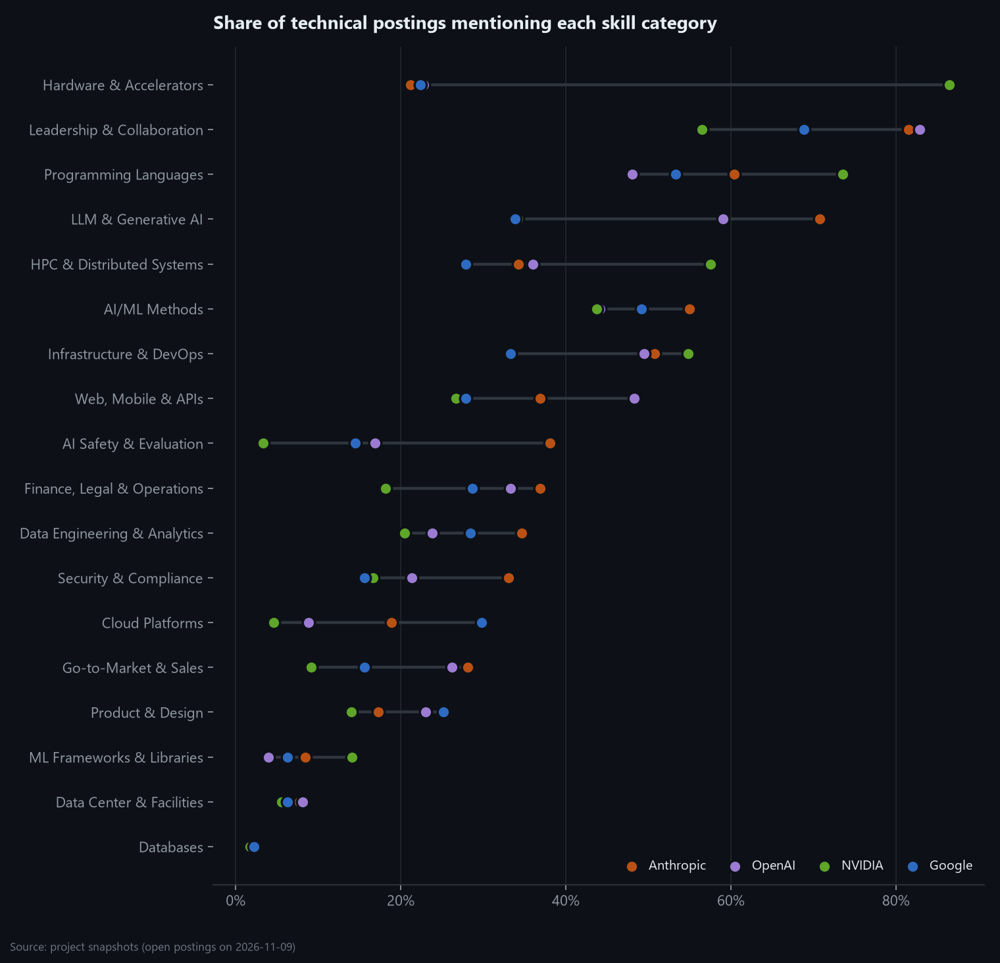
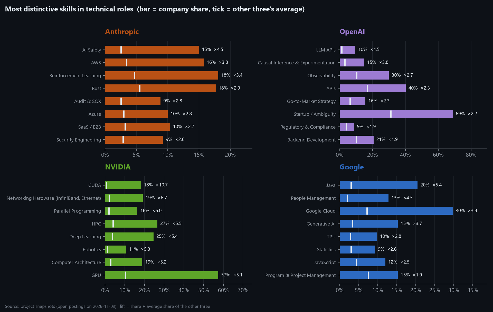
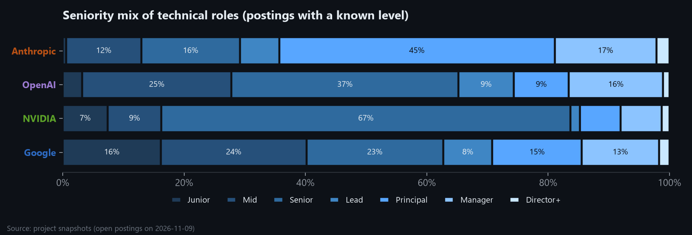
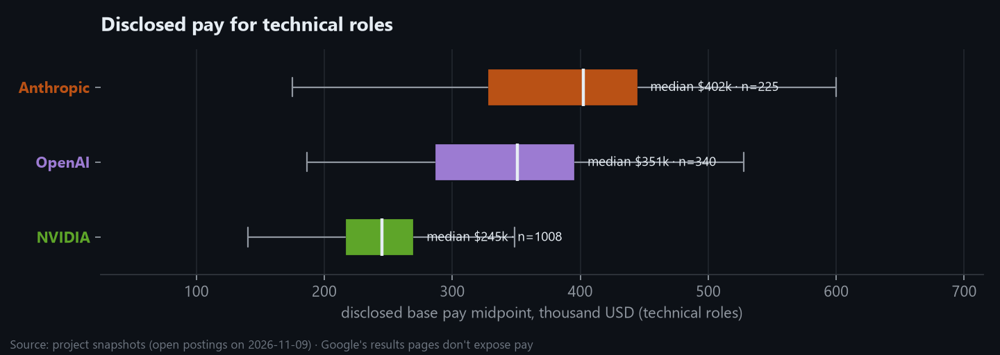
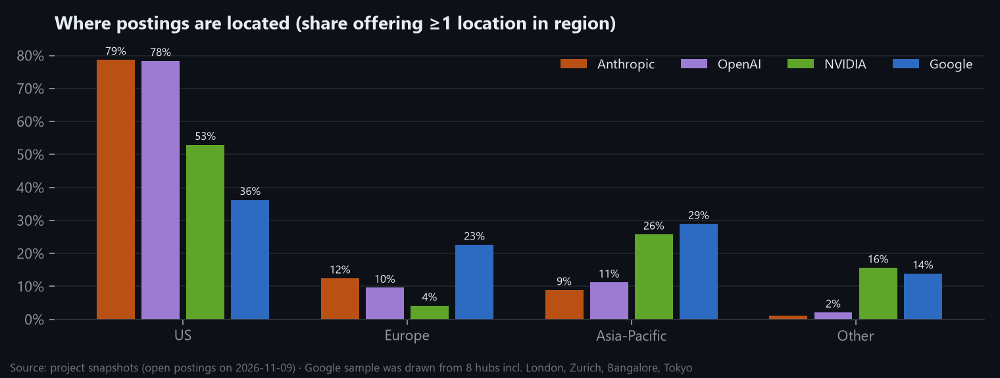

# Competitor Comparison Summary (generated)

Generated by `python -m src.compare.build_comparison` · population: postings open in the latest snapshot · see [Sprint 6](../../docs/sprints/sprint-06-competitor-comparison.md)

> **Lens A (all roles)** is like-for-like only for Anthropic vs OpenAI (full boards). Google is an AI/ML-focused sample and NVIDIA its newest ~100 postings. **Lens B (technical roles)** is like-for-like across all four.

## Company profiles

|                                   | 🟠 Anthropic   | 🟣 OpenAI   | 🟢 NVIDIA   | 🔵 Google   |
|:----------------------------------|:------------|:---------|:---------|:---------|
| open postings (all roles)         | 675         | 813      | 2,799    | 917      |
| technical roles                   | 260         | 408      | 2,059    | 366      |
| technical share of postings       | 39%         | 50%      | 74%      | 40%      |
| median skills / tech posting      | 11          | 10       | 10       | 8        |
| median tech skills / tech posting | 8           | 6        | 8        | 6        |
| median min. years (tech)          | 7           | 7        | 5        | 3        |
| years stated (tech)               | 48%         | 36%      | 79%      | 93%      |
| PhD mentioned (tech)              | 5%          | 3%       | 29%      | 45%      |
| PhD required (tech)               | 3%          | 3%       | 26%      | 6%       |
| 'or equivalent experience' (tech) | 8%          | 12%      | 80%      | 93%      |
| people managers (all roles)       | 19%         | 15%      | 11%      | 13%      |
| remote-friendly (all roles)       | 11%         | 7%       | 7%       | 0%       |
| multi-location postings           | 60%         | 19%      | 0%       | 38%      |
| offers a US location              | 79%         | 78%      | 53%      | 36%      |
| offers Europe                     | 12%         | 10%      | 4%       | 23%      |
| offers Asia-Pacific               | 9%          | 11%      | 26%      | 29%      |
| pay disclosed (tech)              | 87%         | 83%      | 49%      | 2%       |
| median pay midpoint, USD (tech)   | $402k       | $351k    | $245k    | —        |

## Role-family mix (lens A, all roles)

| role_family                | 🟠 Anthropic   | 🟣 OpenAI   | 🟢 NVIDIA   | 🔵 Google   |
|:---------------------------|:------------|:---------|:---------|:---------|
| Sales & Go-to-Market       | 29%         | 25%      | 10%      | 32%      |
| Finance, Legal & People    | 11%         | 7%       | 2%       | 3%       |
| Software Engineering       | 10%         | 20%      | 27%      | 9%       |
| Safety, Policy & Trust     | 8%          | 4%       | 1%       | 3%       |
| Research                   | 8%          | 6%       | 2%       | 2%       |
| Infrastructure & SRE       | 7%          | 8%       | 11%      | 13%      |
| Security & Privacy         | 6%          | 4%       | 2%       | 4%       |
| Data Center & Facilities   | 5%          | 3%       | 4%       | 6%       |
| ML / AI Engineering        | 4%          | 8%       | 7%       | 4%       |
| Marketing & Communications | 3%          | 6%       | 4%       | 4%       |
| Product & Design           | 3%          | 2%       | 3%       | 3%       |
| Program Management         | 2%          | 2%       | 2%       | 2%       |
| Data & Analytics           | 2%          | 2%       | 1%       | 3%       |
| Hardware & Silicon         | 1%          | 3%       | 24%      | 5%       |
| Other                      | 0%          | 1%       | 2%       | 6%       |

## Skill-category profile (lens B, technical roles)

| category                     | 🟠 Anthropic   | 🟣 OpenAI   | 🟢 NVIDIA   | 🔵 Google   |
|:-----------------------------|:------------|:---------|:---------|:---------|
| AI Safety & Evaluation       | 38%         | 17%      | 3%       | 14%      |
| AI/ML Methods                | 55%         | 44%      | 44%      | 49%      |
| Cloud Platforms              | 19%         | 9%       | 5%       | 30%      |
| Data Center & Facilities     | 8%          | 8%       | 6%       | 6%       |
| Data Engineering & Analytics | 35%         | 24%      | 20%      | 28%      |
| Databases                    | 2%          | 2%       | 2%       | 2%       |
| Finance, Legal & Operations  | 37%         | 33%      | 18%      | 29%      |
| Go-to-Market & Sales         | 28%         | 26%      | 9%       | 16%      |
| HPC & Distributed Systems    | 34%         | 36%      | 58%      | 28%      |
| Hardware & Accelerators      | 21%         | 23%      | 86%      | 22%      |
| Infrastructure & DevOps      | 51%         | 50%      | 55%      | 33%      |
| LLM & Generative AI          | 71%         | 59%      | 34%      | 34%      |
| Leadership & Collaboration   | 82%         | 83%      | 56%      | 69%      |
| ML Frameworks & Libraries    | 8%          | 4%       | 14%      | 6%       |
| Product & Design             | 17%         | 23%      | 14%      | 25%      |
| Programming Languages        | 60%         | 48%      | 74%      | 53%      |
| Security & Compliance        | 33%         | 21%      | 17%      | 16%      |
| Spoken Languages             | 1%          | 6%       | 8%       | 4%       |
| Web, Mobile & APIs           | 37%         | 48%      | 27%      | 28%      |

## Distinctive skills (lens B)

**🟠 Anthropic**
- over-indexes on: AI Safety (15% vs 3%) · AWS (16% vs 3%) · Reinforcement Learning (18% vs 5%) · Rust (18% vs 6%) · Audit & SOX (9% vs 3%) · Azure (10% vs 3%) · SaaS / B2B (10% vs 3%) · Security Engineering (9% vs 3%) · Model Evaluation (20% vs 7%) · Large Language Models (46% vs 20%)
- under-indexes on: C++ (7% vs 26%)

**🟣 OpenAI**
- over-indexes on: LLM APIs (10% vs 1%) · Causal Inference & Experimentation (15% vs 3%) · Observability (30% vs 10%) · APIs (40% vs 17%) · Go-to-Market Strategy (16% vs 6%) · Startup / Ambiguity (69% vs 31%) · Regulatory & Compliance (9% vs 4%) · Backend Development (21% vs 10%) · TypeScript (10% vs 5%) · JavaScript (10% vs 5%)
- under-indexes on: GPU (10% vs 26%) · C++ (11% vs 25%) · Google Cloud (3% vs 16%)

**🟢 NVIDIA**
- over-indexes on: CUDA (18% vs 1%) · Networking Hardware (InfiniBand, Ethernet) (19% vs 2%) · Parallel Programming (16% vs 2%) · HPC (27% vs 4%) · Deep Learning (25% vs 4%) · Robotics (11% vs 1%) · Computer Architecture (19% vs 3%) · GPU (57% vs 10%) · EDA Tools (10% vs 1%) · Interconnects (NVLink, PCIe, CXL) (12% vs 2%)
- under-indexes on: Startup / Ambiguity (15% vs 49%) · Cross-functional Collaboration (15% vs 32%) · Google Cloud (2% vs 16%) · Distributed Systems (10% vs 22%) · Site Reliability Engineering (6% vs 16%)

**🔵 Google**
- over-indexes on: Java (20% vs 3%) · People Management (13% vs 2%) · Google Cloud (30% vs 7%) · Generative AI (15% vs 3%) · TPU (10% vs 3%) · Statistics (9% vs 3%) · JavaScript (12% vs 4%) · Program & Project Management (15% vs 7%) · Product Management (17% vs 9%) · Data Analysis (20% vs 11%)
- under-indexes on: Startup / Ambiguity (20% vs 47%) · GPU (6% vs 28%) · Communication Skills (8% vs 28%) · APIs (9% vs 27%) · Observability (4% vs 19%)

## Seniority (lens B)

| seniority_level   | 🟠 Anthropic   | 🟣 OpenAI   | 🟢 NVIDIA   | 🔵 Google   |
|:------------------|:------------|:---------|:---------|:---------|
| Intern            | 0%          | 0%       | 7%       | 3%       |
| Junior            | 0%          | 1%       | 7%       | 15%      |
| Mid               | 9%          | 11%      | 8%       | 23%      |
| Senior            | 12%         | 17%      | 60%      | 21%      |
| Lead              | 5%          | 4%       | 1%       | 8%       |
| Principal         | 32%         | 4%       | 6%       | 14%      |
| Manager           | 12%         | 7%       | 6%       | 12%      |
| Director+         | 2%          | 0%       | 1%       | 2%       |
| Unspecified       | 29%         | 54%      | 5%       | 2%       |

## Pay (lens B, where disclosed)

## Locations (lens A)

| company   | top hubs                                                                              |
|:----------|:--------------------------------------------------------------------------------------|
| 🟠 Anthropic | San Francisco 61% · Remote 7% · New York 6% · London 6% · Tokyo 2% · Munich 2%        |
| 🟣 OpenAI    | San Francisco 67% · Singapore 5% · New York 4% · Tokyo 4% · London 3% · Washington 3% |
| 🟢 NVIDIA    | Santa Clara 47% · Israel 15% · India 9% · China 9% · Taiwan 5% · Remote 3%            |
| 🔵 Google    | Singapore 7% · Bangalore 6% · New York 5% · Tokyo 5% · Mountain View 5% · London 5%   |

## How skills are framed (lens B)

Share of skill mentions by section. Higher *in preferred* means more nice-to-haves.

|                     | 🟠 Anthropic   | 🟣 OpenAI   | 🟢 NVIDIA   | 🔵 Google   |
|:--------------------|:------------|:---------|:---------|:---------|
| in requirements     | 46%         | 59%      | 50%      | 42%      |
| in preferred        | 36%         | 7%       | 29%      | 35%      |
| in responsibilities | 34%         | 39%      | 32%      | 30%      |
| context only        | 7%          | 13%      | 13%      | 13%      |
