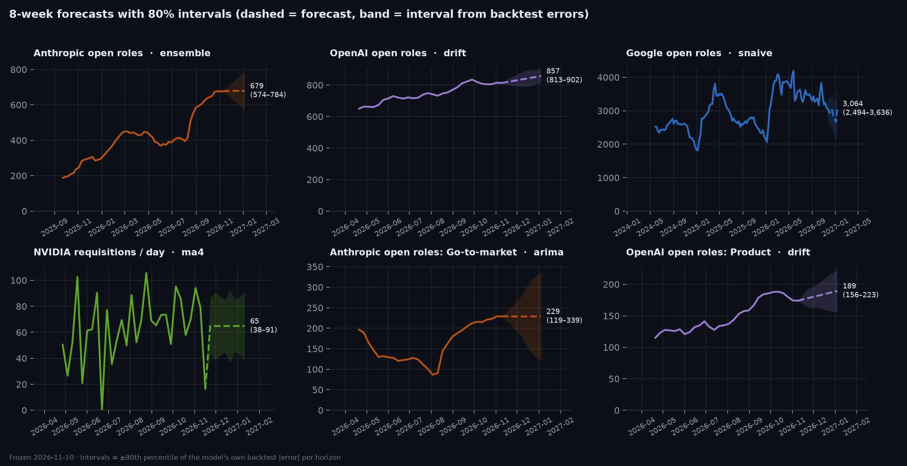
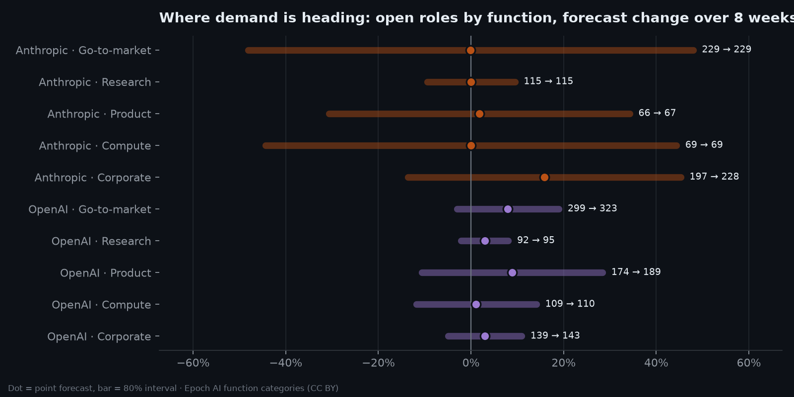
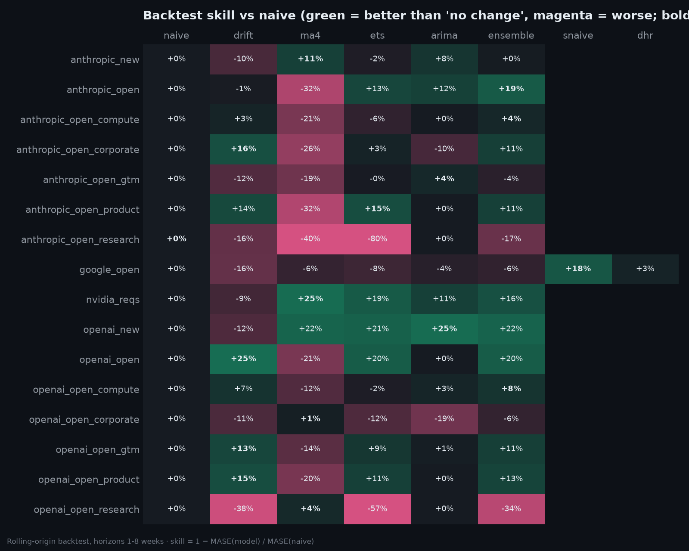

# Demand Forecast Summary (generated)

Generated by `python -m src.forecast.report` · forecasts frozen 2026-11-10 · see [Sprint 7](../../docs/sprints/sprint-07-demand-forecasting.md) · live scoring: [scorecard](scorecard.md)

## All series (8-week horizon)

| series                   | company   | model    | skill vs naive   |   history (weeks) |   last |   in 8 weeks | 80% interval   |   backtest bias |
|:-------------------------|:----------|:---------|:-----------------|------------------:|-------:|-------------:|:---------------|----------------:|
| anthropic_open           | 🟠 Anthropic | ensemble | +19%             |               131 |    676 |          679 | 574–784        |             +41 |
| openai_open              | 🟣 OpenAI    | drift    | +25%             |                35 |    813 |          857 | 813–902        |             +10 |
| google_open              | 🔵 Google    | snaive   | +18%             |               178 |  3,001 |        2,984 | 2,413–3,555    |             +70 |
| anthropic_open_gtm       | 🟠 Anthropic | arima    | +4%              |                35 |    229 |          229 | 119–339        |             +67 |
| anthropic_open_research  | 🟠 Anthropic | arima    | +0%              |                35 |    115 |          115 | 104–126        |              +9 |
| anthropic_open_product   | 🟠 Anthropic | ets      | +16%             |                35 |     66 |           67 | 46–89          |             +10 |
| anthropic_open_compute   | 🟠 Anthropic | ensemble | +4%              |                35 |     69 |           69 | 38–100         |             +16 |
| anthropic_open_corporate | 🟠 Anthropic | drift    | +16%             |                35 |    197 |          228 | 170–286        |             +40 |
| openai_open_gtm          | 🟣 OpenAI    | drift    | +13%             |                35 |    299 |          323 | 290–356        |             +19 |
| openai_open_research     | 🟣 OpenAI    | ma4      | +4%              |                35 |     92 |           95 | 90–99          |              -2 |
| openai_open_product      | 🟣 OpenAI    | drift    | +16%             |                35 |    174 |          189 | 156–223        |             +16 |
| openai_open_compute      | 🟣 OpenAI    | ensemble | +8%              |                35 |    109 |          110 | 96–124         |              +0 |
| openai_open_corporate    | 🟣 OpenAI    | ma4      | +1%              |                35 |    139 |          143 | 132–154        |              -7 |
| anthropic_new            | 🟠 Anthropic | ma4      | +11%             |                34 |      6 |           40 | 10–70          |              -0 |
| openai_new               | 🟣 OpenAI    | arima    | +25%             |                34 |      4 |           52 | 35–68          |              +1 |
| nvidia_reqs              | 🟢 NVIDIA    | ma4      | +25%             |                31 |     16 |           65 | 38–91          |              -3 |

*backtest bias* > 0 means the model under-forecast during the backtest (common during growth).

## Function outlook

| company   | function     |   now |   in_8_weeks | change   | model    | interval     |
|:----------|:-------------|------:|-------------:|:---------|:---------|:-------------|
| 🟠 Anthropic | Go-to-market |   229 |        228.8 | -0%      | arima    | -48% to +48% |
| 🟠 Anthropic | Research     |   115 |        115   | +0%      | arima    | -9% to +9%   |
| 🟠 Anthropic | Product      |    66 |         67.2 | +2%      | ets      | -31% to +34% |
| 🟠 Anthropic | Compute      |    69 |         69   | +0%      | ensemble | -44% to +44% |
| 🟠 Anthropic | Corporate    |   197 |        228.2 | +16%     | drift    | -14% to +45% |
| 🟣 OpenAI    | Go-to-market |   299 |        322.8 | +8%      | drift    | -3% to +19%  |
| 🟣 OpenAI    | Research     |    92 |         94.7 | +3%      | ma4      | -2% to +8%   |
| 🟣 OpenAI    | Product      |   174 |        189.4 | +9%      | drift    | -11% to +28% |
| 🟣 OpenAI    | Compute      |   109 |        110.2 | +1%      | ensemble | -12% to +14% |
| 🟣 OpenAI    | Corporate    |   139 |        143.2 | +3%      | ma4      | -5% to +11%  |

## Model selection

