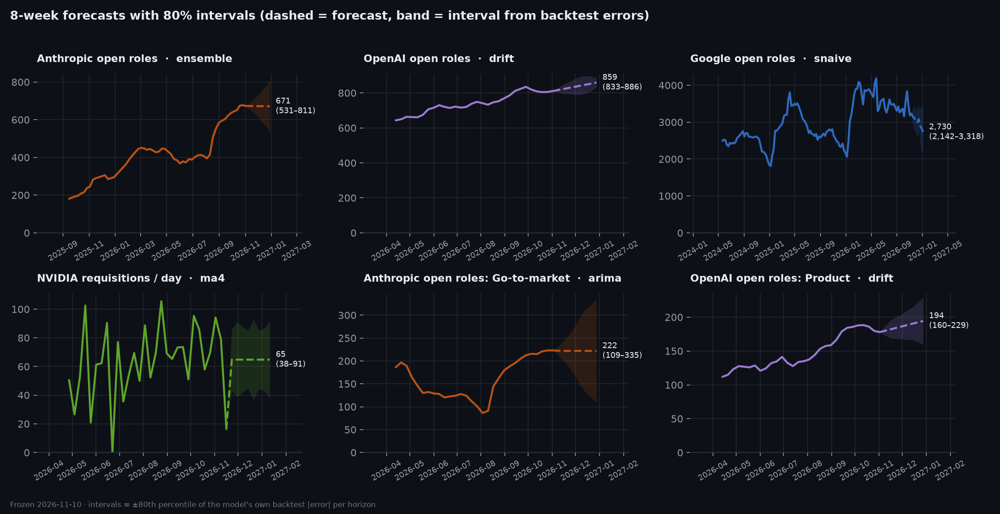
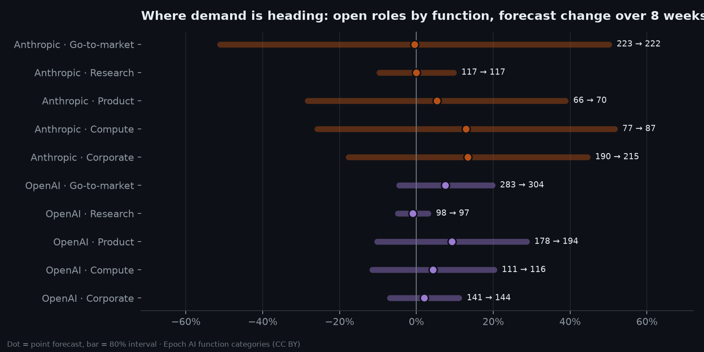
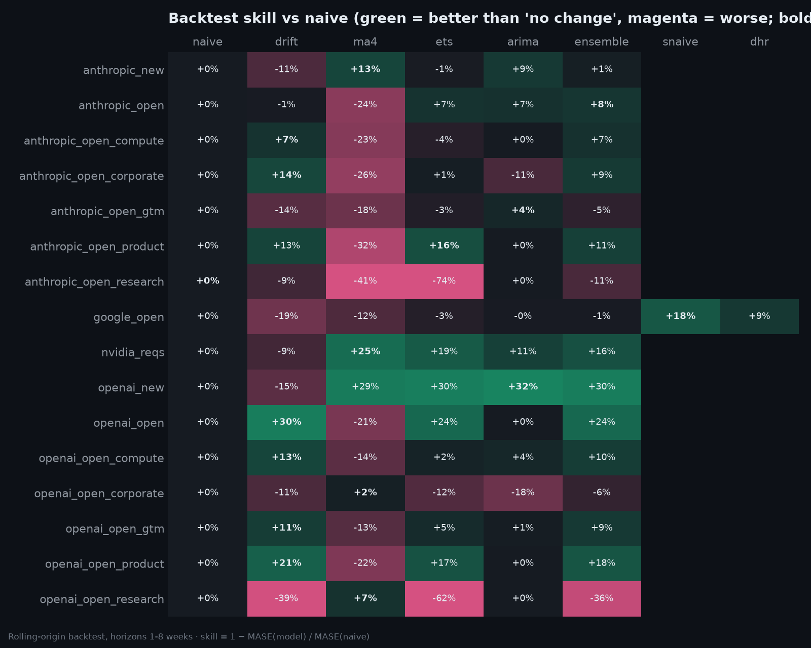

# Demand Forecast Summary (generated)

Generated by `python -m src.forecast.report` · forecasts frozen 2026-11-10 · see [Sprint 7](../../docs/sprints/sprint-07-demand-forecasting.md) · live scoring: [scorecard](scorecard.md)

## All series (8-week horizon)

| series                   | company   | model    | skill vs naive   |   history (weeks) |   last |   in 8 weeks | 80% interval   |   backtest bias |
|:-------------------------|:----------|:---------|:-----------------|------------------:|-------:|-------------:|:---------------|----------------:|
| anthropic_open           | 🟠 Anthropic | ensemble | +8%              |               130 |    673 |          671 | 531–811        |             +50 |
| openai_open              | 🟣 OpenAI    | drift    | +30%             |                34 |    811 |          859 | 833–886        |             +16 |
| google_open              | 🔵 Google    | snaive   | +18%             |               177 |  3,229 |        2,730 | 2,142–3,318    |             +85 |
| anthropic_open_gtm       | 🟠 Anthropic | arima    | +4%              |                34 |    223 |          222 | 109–335        |             +70 |
| anthropic_open_research  | 🟠 Anthropic | arima    | +0%              |                34 |    117 |          117 | 106–128        |             +10 |
| anthropic_open_product   | 🟠 Anthropic | ets      | +16%             |                34 |     66 |           70 | 47–92          |             +10 |
| anthropic_open_compute   | 🟠 Anthropic | drift    | +8%              |                34 |     77 |           87 | 57–117         |             +18 |
| anthropic_open_corporate | 🟠 Anthropic | drift    | +14%             |                34 |    190 |          215 | 156–274        |             +41 |
| openai_open_gtm          | 🟣 OpenAI    | drift    | +10%             |                34 |    283 |          304 | 270–339        |             +18 |
| openai_open_research     | 🟣 OpenAI    | ma4      | +7%              |                34 |     98 |           97 | 93–101         |              -2 |
| openai_open_product      | 🟣 OpenAI    | drift    | +21%             |                34 |    178 |          194 | 160–229        |             +20 |
| openai_open_compute      | 🟣 OpenAI    | drift    | +13%             |                34 |    111 |          116 | 98–133         |              -8 |
| openai_open_corporate    | 🟣 OpenAI    | ma4      | +2%              |                34 |    141 |          144 | 131–157        |              -7 |
| anthropic_new            | 🟠 Anthropic | ma4      | +13%             |                33 |     56 |           49 | 21–77          |              +4 |
| openai_new               | 🟣 OpenAI    | arima    | +32%             |                33 |     64 |           53 | 39–67          |              +5 |
| nvidia_reqs              | 🟢 NVIDIA    | ma4      | +25%             |                31 |     16 |           65 | 38–91          |              -3 |

*backtest bias* > 0 means the model under-forecast during the backtest (common during growth).

## Function outlook

| company   | function     |   now |   in_8_weeks | change   | model   | interval     |
|:----------|:-------------|------:|-------------:|:---------|:--------|:-------------|
| 🟠 Anthropic | Go-to-market |   223 |        221.9 | -0%      | arima   | -51% to +50% |
| 🟠 Anthropic | Research     |   117 |        117   | +0%      | arima   | -10% to +10% |
| 🟠 Anthropic | Product      |    66 |         69.5 | +5%      | ets     | -28% to +39% |
| 🟠 Anthropic | Compute      |    77 |         86.9 | +13%     | drift   | -26% to +52% |
| 🟠 Anthropic | Corporate    |   190 |        215.4 | +13%     | drift   | -18% to +44% |
| 🟣 OpenAI    | Go-to-market |   283 |        304.4 | +8%      | drift   | -5% to +20%  |
| 🟣 OpenAI    | Research     |    98 |         97.1 | -1%      | ma4     | -5% to +3%   |
| 🟣 OpenAI    | Product      |   178 |        194.4 | +9%      | drift   | -10% to +29% |
| 🟣 OpenAI    | Compute      |   111 |        115.8 | +4%      | drift   | -12% to +20% |
| 🟣 OpenAI    | Corporate    |   141 |        143.9 | +2%      | ma4     | -7% to +11%  |

## Model selection

