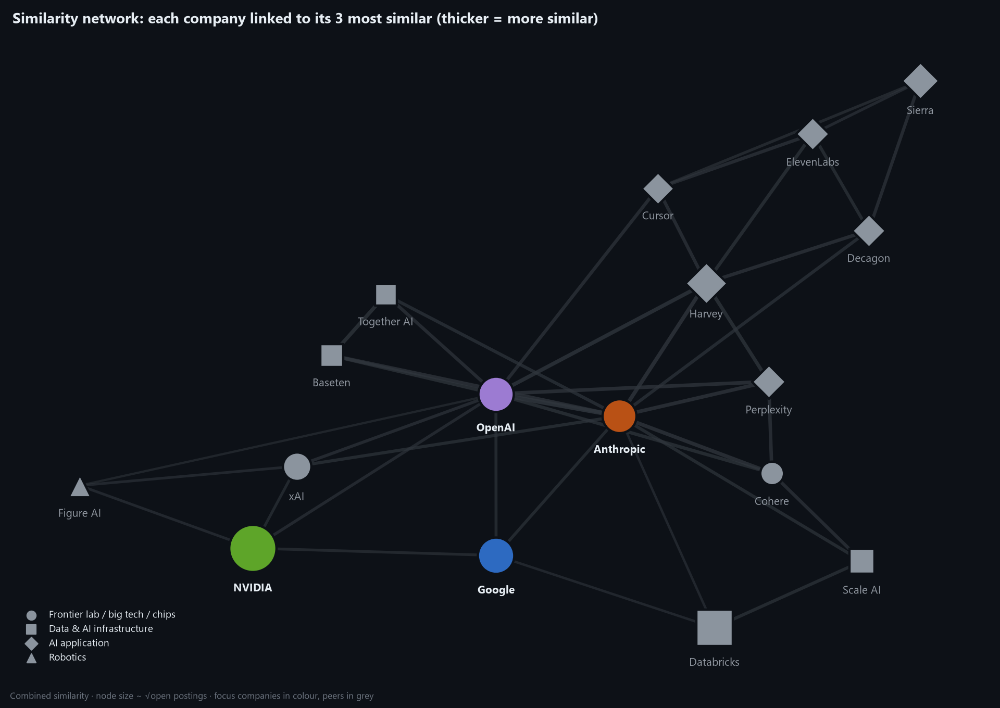
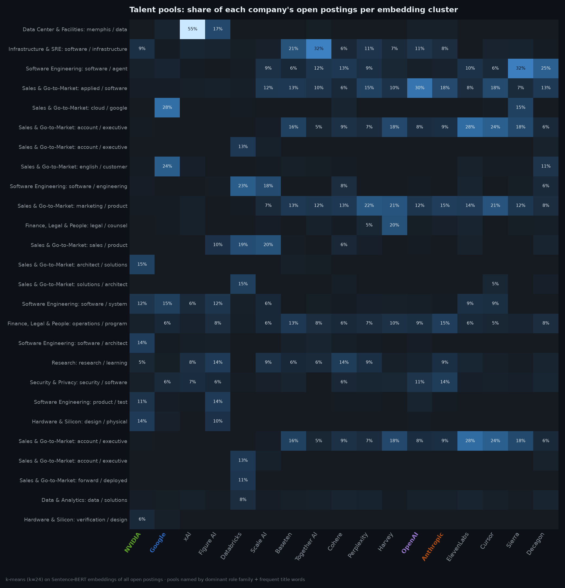
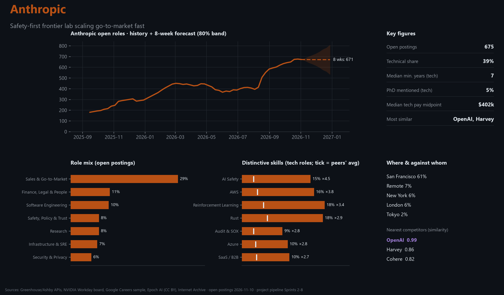
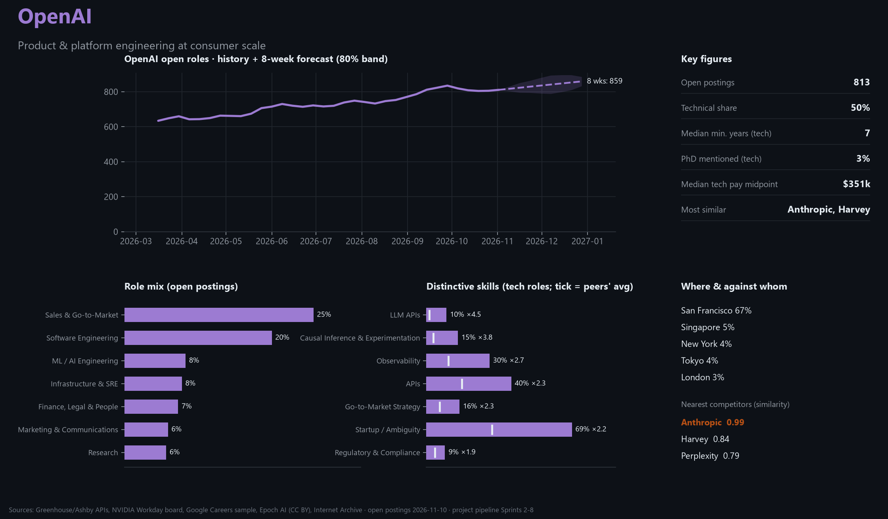
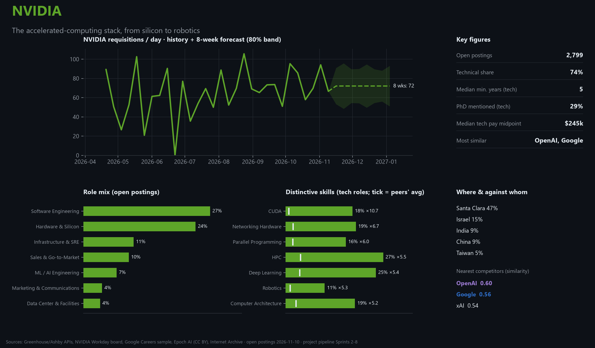
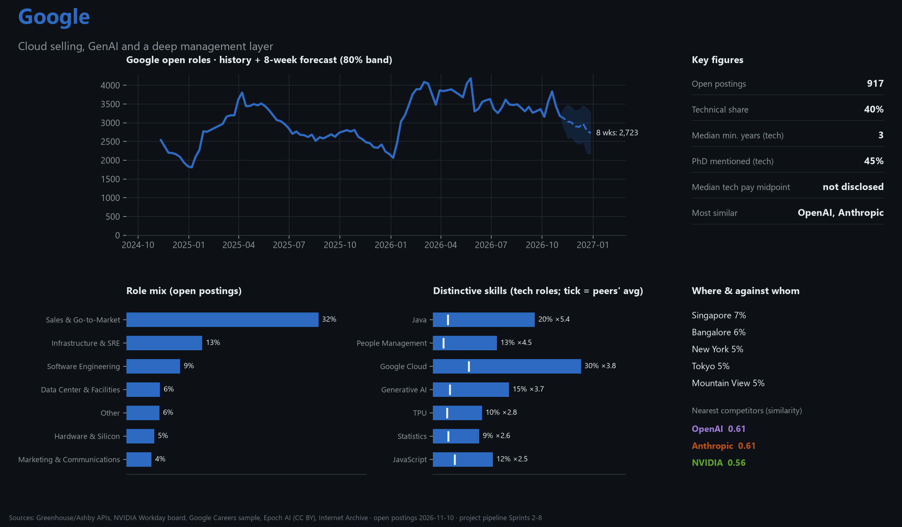
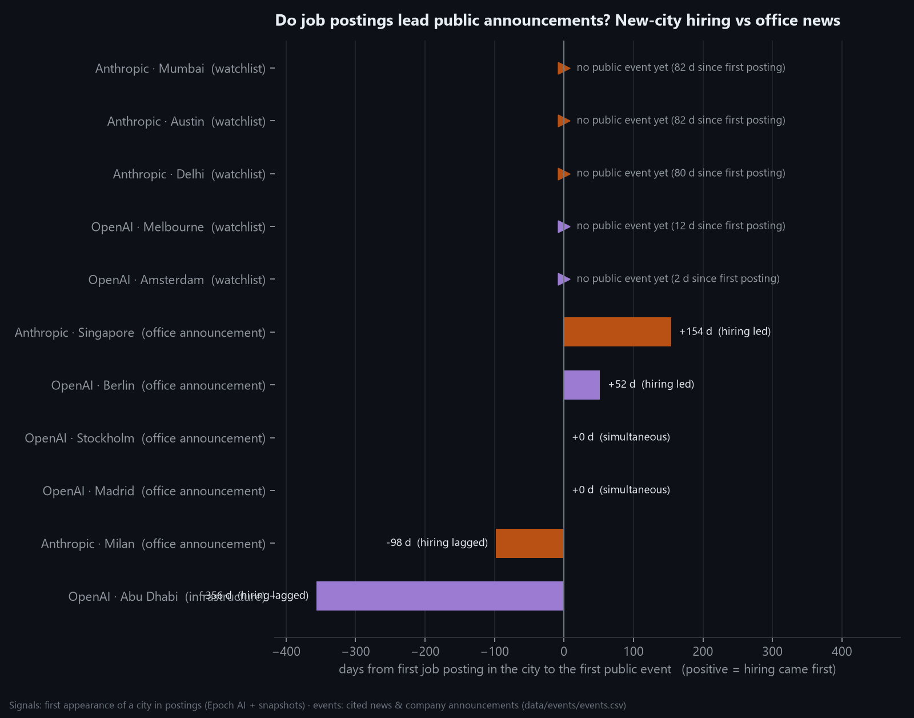
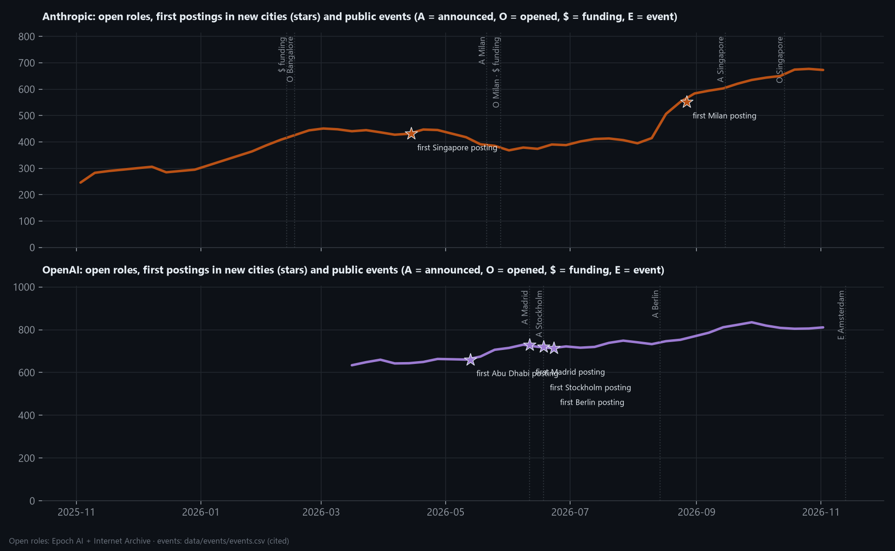

# Hiring Intelligence Report: the AI Talent Market, November 2026

**Focus companies:** 🟠 Anthropic · 🟣 OpenAI · 🟢 NVIDIA · 🔵 Google, benchmarked against 13 AI-market peers.
**Evidence base:** 11,223 job postings (open roles on 2026-11-10 + Epoch AI history since March 2026),
Internet Archive open-role counts back to 2023, 13 cited public events.
**Method:** Sprints 2–8 of this project ([README](../../README.md)). Every number below links back to a reproducible table.

---

## Executive summary

1. **The frontier labs are becoming enterprise-software companies.** 29% of Anthropic's and 25% of OpenAI's open
   roles are sales/go-to-market. Their closest hiring "twins" among 13 peers are enterprise-AI vendors (Harvey,
   Perplexity, Cohere), not research labs. The most contested talent pool in the market is **enterprise account
   executives**.
2. **🟠 Anthropic is in a hiring surge, financed by its May mega-round.** Open roles: about 74 (late 2024) → 667 now
   (about 9×). After its $65B Series H (May 28) open roles rose **+184 in 13 weeks and +305 in 26 weeks**. The earlier
   $30B round produced no such surge, so money enables growth but doesn't time it.
3. **🟣 OpenAI grows steadily and broadly** (product +9%, GTM +8% forecast over the next 8 weeks) and is the most
   **product-platform** employer (APIs 40% of tech postings vs 17% elsewhere).
4. **🟢 NVIDIA and 🔵 Google play different games.** NVIDIA hires the hardware/HPC stack (CUDA ×10.7, interconnects,
   robotics) at about 70–80 requisitions a day, accelerating since spring. Google combines Cloud selling (32% of its
   sample), GenAI/TPU work and the deepest management layer, with a predictable yearly hiring cycle.
5. **Do job postings predict company moves? Sometimes, and it can be measured.** In 2 of 6 checked expansions,
   hiring preceded the announcement (Anthropic Singapore by **154 days**, OpenAI Berlin by **52 days**); in 2 it was
   simultaneous and in 2 it lagged. Five **unannounced** new-city signals form a live watchlist (below).

---

## 1. The market picture

- **Two blocs.** An *LLM + go-to-market* bloc (Anthropic, OpenAI, Harvey, Perplexity, Cohere, Baseten; combined
  similarity 0.70–0.99) and a *physical-AI* corner (NVIDIA, xAI, Figure AI). Google sits between them (0.61 to both
  labs, 0.56 to NVIDIA). [Sprint 8](../../docs/sprints/sprint-08-similarity-scoring.md)
- **Where the talent fight is:** enterprise AEs (30–33% of postings at Harvey, ElevenLabs, Cursor; 12–15% at the
  labs), product-software engineers (13–19% at the labs, Perplexity, Cursor) and inference/infra engineers
  (Together AI 34%, Baseten 20%). xAI is an outlier: **53% of its open roles are data-center build-out**.
- **What's rising beyond the skill taxonomy** (Anthropic + OpenAI, early vs recent 13 weeks):
  - **Deploying AI at customers:** "customer sites" 16 → 58 postings, "sustained adoption" 2 → 26.
  - **Government & national security:** TS/SCI clearances 3 → 20 postings.
  - **AI-tool fluency as a baseline:** "AI tools" 54 → 129.
  - **New segments:** SMB, DACH.

  [Sprint 5](../../docs/sprints/sprint-05-hiring-trends.md#b-emerging-signals-the-taxonomy-missed)

---

## 2. Company profiles

Each profile follows the same structure: **position · hiring strategy · signals · 8-week outlook · so what.**

### 🟠 Anthropic

- **Position:** frontier lab in a **commercial scale-up phase**; the OpenAI twin (0.99) with a stronger
  research/safety identity.
- **Hiring strategy:** go-to-market first (29% of roles; GTM openings 84 → 223 between Aug and Oct), corporate
  build-out (finance/legal/people 11%, corporate openings 80 → 190). Technical hiring is senior (45% of known-level
  tech roles are Staff+) and the best paid (median disclosed tech midpoint about $402k).
- **Signature skills:** AI safety (15% vs 3% for peers), reinforcement learning, Rust, **multi-cloud** (AWS/Azure ~3×
  peers), audit/SOX (compliance at scale).
- **Signals:** new cities Singapore (Apr) → Mumbai, Delhi, Milan, Austin (Aug). Singapore preceded its office
  announcement by 154 days.
- **8-week outlook:** total open roles flat at about 671 (531–811). GTM plateaus (223 → 222) while compute (+13%) and
  corporate (+13%) keep growing. Intervals are wide: Anthropic grows in bursts.
- **So what:** expect enterprise-sales competition in **India** and **Southern Europe** next. Talent teams competing
  with Anthropic for senior ML/safety staff face the highest pay benchmark in the set.

### 🟣 OpenAI

- **Position:** the largest lab board (813 open roles), the **product & platform** employer of the set.
- **Hiring strategy:** steady, broad growth (+29% open roles since March, the smoothest trajectory of any company);
  software engineering 20% of roles; GTM 25% but a falling share of new postings, with marketing, data-center and
  ML-engineering shares rising.
- **Signature skills:** APIs (40% vs 17%), observability, backend, **experimentation/causal inference** (15% vs 3%),
  LLM APIs. Postings state firm requirements (only 7% of skills phrased as nice-to-haves).
- **Signals:** European build-out (Madrid, Stockholm, Berlin in June; Berlin postings led the announcement by 52
  days), Abu Dhabi hiring a year after Stargate UAE. New watch: **Melbourne, Amsterdam**.
- **8-week outlook:** 811 → **859 (833–886)** open roles; product +9%, GTM +8%, compute +4%. The tightest intervals of
  any company, because its growth has been consistent.
- **So what:** for platform/infra engineers OpenAI is the steadiest bidder; for partners, expect more local
  go-to-market presence across Europe and APAC.

### 🟢 NVIDIA

- **Position:** the market's hardware backbone; least similar to everyone (best match OpenAI 0.60).
- **Hiring strategy:** 2,799 open roles, 74% technical (software 27%, hardware & silicon 24%); the most
  Asia-weighted footprint (Israel 15%, India 9%, China 9%, Taiwan 5%). **Requisitions created rose from ~45–55/day in
  spring to ~70–80/day in autumn.**
- **Signature skills:** CUDA (×10.7 vs peers), InfiniBand/Ethernet networking, parallel programming, HPC, computer
  architecture, EDA tools, and **robotics (×5.3)**, its physical-AI bet.
- **Credentials:** the highest PhD *requirement* (26% of tech roles), yet 80% accept equivalent experience.
- **8-week outlook:** about 72 requisitions/day (51–93), i.e. sustained high activity.
- **So what:** hardware, HPC and networking talent markets stay tight; NVIDIA's robotics hiring is an early marker
  for physical-AI demand.

### 🔵 Google

- **Position:** a hybrid of lab-style AI hiring and big-company engineering, at about 3,000–3,800 open roles.
- **Hiring strategy:** **Cloud selling** (32% of the sample is sales/GTM), infrastructure 13%; the deepest
  management layer (people management 13% vs 2% for peers; program and product management also high); hires across
  levels (lowest median minimum years: 3).
- **Signature skills:** Google Cloud, Java, **Generative AI** (15% vs 3%) and **TPU** (10%), its own silicon, plus
  statistics and data analysis.
- **Signals:** a **predictable yearly cycle** visible across 2023–26: spring peaks, December–January troughs.
- **8-week outlook:** the seasonal dip to about **2,723 (2,152–3,294)** by late December, then the usual January
  rebound.
- **So what:** time recruiting and partnership pushes around Google's cycle; competing for Google talent is easiest
  at its seasonal trough.

*Caveat:* Google's hub list reflects the sampling design (same number of postings per hub), not its real
geographic distribution.

---

## 3. Do job postings predict company moves?

| Evidence | Result |
|---|---|
| New-city postings vs office news (6 cases) | **2 led** (Singapore +154 d, Berlin +52 d), **2 simultaneous** (Madrid, Stockholm), **2 lagged** (Milan −98 d, Abu Dhabi −356 d) |
| Funding → hiring (Anthropic) | Series G (Feb): −8 open roles over 13 weeks. Series H (May): **+184 in 13 weeks, +305 in 26** |
| Forecasting from hiring's own history | Best models beat "no change" by up to 32% (backtest), but **nobody could have forecast Anthropic's August surge** from its own past |

**Verdict:** job postings are a *useful but not infallible* leading indicator. They lead when companies **staff up
before announcing** (Singapore, Berlin). They're simultaneous when hiring *is* the announcement (Madrid, Stockholm).
They lag when a company announces a place before staffing it (Milan, Stargate UAE). The value is in **monitoring
continuously** and treating unexplained new signals as hypotheses.

### Live watchlist: unannounced signals (as of 2026-11-10)

| Company | City | First posting | Status |
|---|---|---|---|
| 🟠 Anthropic | Mumbai | 2026-08-20 | no public office news (India office is in Bengaluru) |
| 🟠 Anthropic | Delhi | 2026-08-22 | no public office news |
| 🟠 Anthropic | Austin | 2026-08-20 | no public office news |
| 🟣 OpenAI | Melbourne | 2026-10-29 | Sydney office open since Dec 2025; no Melbourne news |
| 🟣 OpenAI | Amsterdam | 2026-11-08 | first OpenAI executive event in Amsterdam on Nov 13; no office announced |

These are falsifiable predictions. They will be re-checked at the final presentation, alongside the
[frozen forecast scorecard](../forecast/scorecard.md).

---

## 4. What this means, by audience

| Audience | Insight | Action |
|---|---|---|
| **Strategy teams** | Labs are converging with enterprise-AI vendors; physical AI is a separate race | Benchmark against the bloc you actually compete in (see [similarity](../similarity/summary.md)), not just headline rivals |
| **HR & talent** | Enterprise AEs, product engineers and inference engineers are the contested pools; Anthropic sets the pay ceiling for senior AI roles | Expect bidding wars in those pools; time Google-adjacent hiring to its December trough |
| **Product managers** | "Deploying at customer sites", agents and AI-tool fluency are rising requirements | Plan for forward-deployed and customer-engineering capacity, not just R&D |
| **Investors** | Hiring followed Anthropic's funding with a ~10-week lag; NVIDIA's requisition rate is accelerating | Use open-role and requisition series as near-real-time growth gauges between financial reports |
| **CEOs / CTOs** | Government work (TS/SCI) and international expansion are active fronts | Watch the expansion watchlist and clearance-related hiring as early signs of new markets |

---

## 5. Confidence & limitations

- **Coverage:** full boards for Anthropic, OpenAI, NVIDIA and the 13 peers; Google is an unbiased *sample* (plus
  archive totals). History is longest for Google (3.4 years) and Anthropic (2.5 years); peers have none yet.
- **Events** are a curated set of 13 with sources ([`events.csv`](../../data/events/events.csv)); six lead-lag cases
  are case studies, not statistical proof.
- **Forecasts** are 8-week statistical extrapolations with honest (wide) intervals; their real accuracy is being
  measured prospectively.
- **Skill extraction** is about 89% precise (spot check). Some company-wide statements are removed as boilerplate.
- This report uses only publicly available job postings and public news; no personal data.
