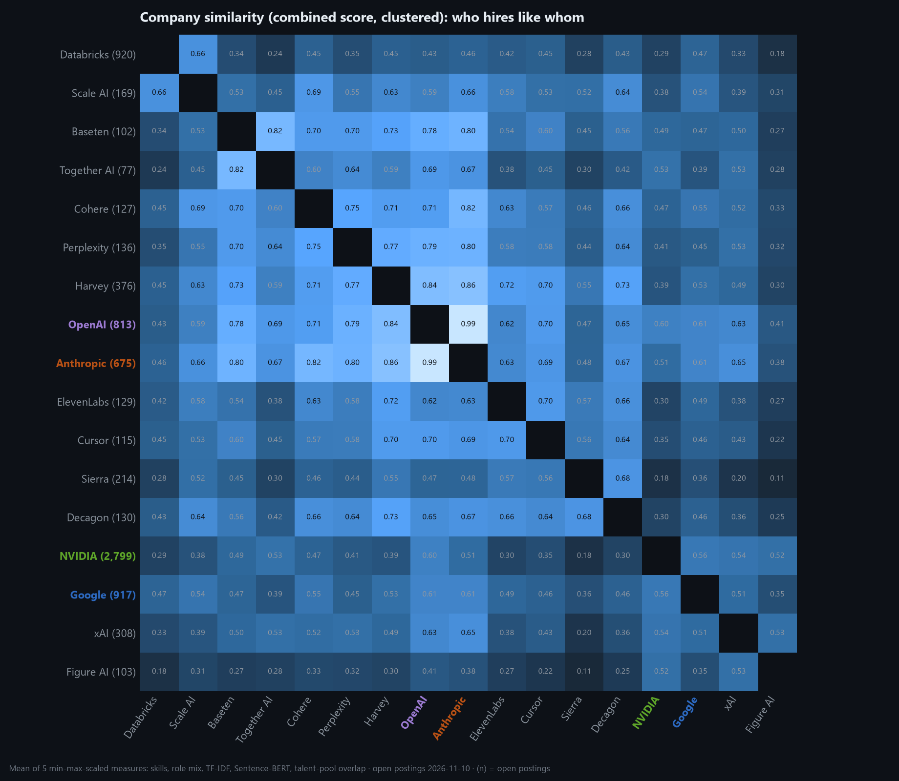
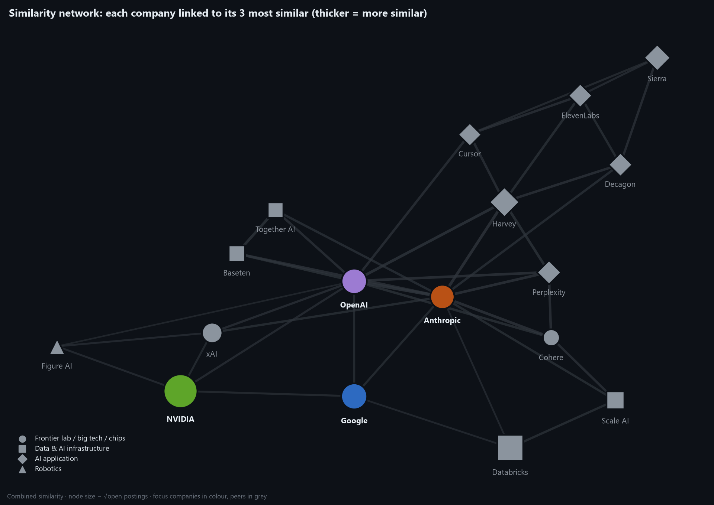
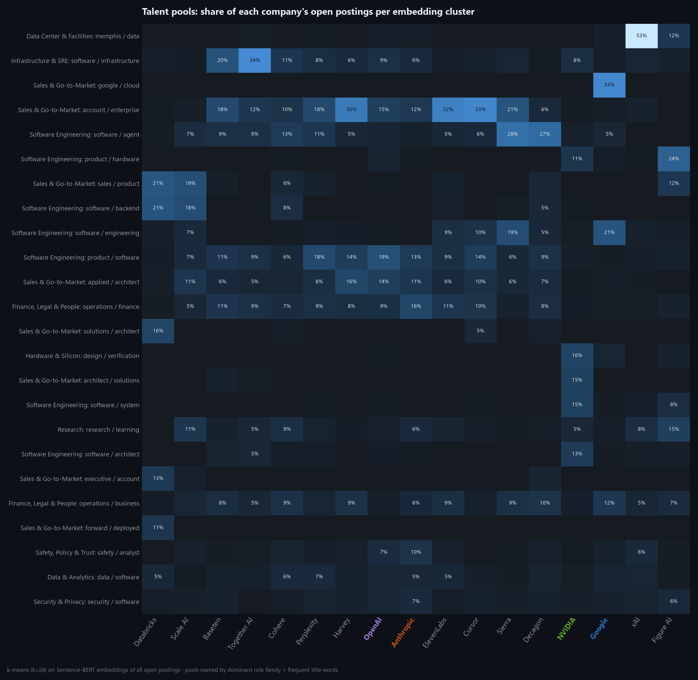

# Company Similarity Summary (generated)

Generated by `python -m src.similarity.build_similarity` · 17 companies · 8,110 open postings (4,105 technical) · see [Sprint 8](../../docs/sprints/sprint-08-similarity-scoring.md)

## Nearest neighbours

| Company | Segment | Open postings | Most similar (combined) |
|---|---|---:|---|
| 🟢 NVIDIA | Semiconductors | 2,799 | 🟣 OpenAI 0.60 · 🔵 Google 0.56 · xAI 0.54 |
| Databricks | Data & AI infrastructure | 920 | Scale AI 0.66 · 🔵 Google 0.47 · 🟠 Anthropic 0.46 |
| 🔵 Google | Big tech | 917 | 🟣 OpenAI 0.61 · 🟠 Anthropic 0.61 · 🟢 NVIDIA 0.56 |
| 🟣 OpenAI | Frontier lab | 813 | 🟠 Anthropic 0.99 · Harvey 0.84 · Perplexity 0.79 |
| 🟠 Anthropic | Frontier lab | 675 | 🟣 OpenAI 0.99 · Harvey 0.86 · Cohere 0.82 |
| Harvey | AI application | 376 | 🟠 Anthropic 0.86 · 🟣 OpenAI 0.84 · Perplexity 0.77 |
| xAI | Frontier lab | 308 | 🟠 Anthropic 0.65 · 🟣 OpenAI 0.63 · 🟢 NVIDIA 0.54 |
| Sierra | AI application | 214 | Decagon 0.68 · ElevenLabs 0.57 · Cursor 0.56 |
| Scale AI | Data & AI infrastructure | 169 | Cohere 0.69 · 🟠 Anthropic 0.66 · Databricks 0.66 |
| Perplexity | AI application | 136 | 🟠 Anthropic 0.80 · 🟣 OpenAI 0.79 · Harvey 0.77 |
| Decagon | AI application | 130 | Harvey 0.73 · Sierra 0.68 · 🟠 Anthropic 0.67 |
| ElevenLabs | AI application | 129 | Harvey 0.72 · Cursor 0.70 · Decagon 0.66 |
| Cohere | Frontier lab | 127 | 🟠 Anthropic 0.82 · Perplexity 0.75 · 🟣 OpenAI 0.71 |
| Cursor | AI application | 115 | Harvey 0.70 · 🟣 OpenAI 0.70 · ElevenLabs 0.70 |
| Figure AI | Robotics | 103 | xAI 0.53 · 🟢 NVIDIA 0.52 · 🟣 OpenAI 0.41 |
| Baseten | Data & AI infrastructure | 102 | Together AI 0.82 · 🟠 Anthropic 0.80 · 🟣 OpenAI 0.78 |
| Together AI | Data & AI infrastructure | 77 | Baseten 0.82 · 🟣 OpenAI 0.69 · 🟠 Anthropic 0.67 |

## Focus-company pairs: what drives similarity

| Pair | Combined | Shared skills (share a/b) | Biggest differences |
|---|---:|---|---|
| 🟠 Anthropic – 🟣 OpenAI | 0.99 | Startup / Ambiguity (58%/69%) · Python (52%/39%) · AI Agents (32%/34%) · Machine Learning (51%/29%) · Large Language Models (46%/26%) | 🟠 Anthropic more: Machine Learning, Large Language Models, Reinforcement Learning — 🟣 OpenAI more: APIs, Observability, Startup / Ambiguity |
| 🟠 Anthropic – 🟢 NVIDIA | 0.51 | Python (52%/54%) · Communication Skills (31%/32%) · Machine Learning (51%/21%) · AI Agents (32%/18%) · Large Language Models (46%/16%) | 🟠 Anthropic more: Startup / Ambiguity, Machine Learning, Large Language Models — 🟢 NVIDIA more: GPU, C++, ASIC / SoC Design |
| 🟠 Anthropic – 🔵 Google | 0.61 | Machine Learning (51%/39%) · Python (52%/39%) · Cross-functional Collaboration (24%/39%) · Technical Leadership (22%/24%) · Startup / Ambiguity (58%/20%) | 🟠 Anthropic more: Startup / Ambiguity, Large Language Models, Communication Skills — 🔵 Google more: C++, Java, Generative AI |
| 🟣 OpenAI – 🟢 NVIDIA | 0.60 | Python (39%/54%) · Machine Learning (29%/21%) · Communication Skills (20%/32%) · Networking (19%/33%) · AI Agents (34%/18%) | 🟣 OpenAI more: Startup / Ambiguity, APIs, Observability — 🟢 NVIDIA more: GPU, C++, Deep Learning |
| 🟣 OpenAI – 🔵 Google | 0.61 | Python (39%/39%) · Cross-functional Collaboration (32%/39%) · Machine Learning (29%/39%) · Startup / Ambiguity (69%/20%) · Networking (19%/19%) | 🟣 OpenAI more: Startup / Ambiguity, APIs, Observability — 🔵 Google more: Google Cloud, C++, Java |
| 🟢 NVIDIA – 🔵 Google | 0.56 | Python (54%/39%) · C++ (37%/31%) · Machine Learning (21%/39%) · Networking (33%/19%) · AI Agents (18%/17%) | 🟢 NVIDIA more: GPU, HPC, Communication Skills — 🔵 Google more: Google Cloud, Cross-functional Collaboration, Machine Learning |

## Top 15 most similar pairs (all companies)

| a          | b           |   skills |   role_mix |   tfidf |   embedding |   talent |   combined |
|:-----------|:------------|---------:|-----------:|--------:|------------:|---------:|-----------:|
| 🟣 OpenAI     | 🟠 Anthropic   |   0.9034 |     0.8091 |  0.7214 |      0.9512 |   0.7853 |     0.9945 |
| 🟠 Anthropic  | Harvey      |   0.8826 |     0.6579 |  0.5565 |      0.9502 |   0.696  |     0.8553 |
| 🟣 OpenAI     | Harvey      |   0.8574 |     0.6438 |  0.5455 |      0.9375 |   0.7317 |     0.8387 |
| Baseten    | Together AI |   0.8025 |     0.6694 |  0.5112 |      0.9114 |   0.8043 |     0.8186 |
| 🟠 Anthropic  | Cohere      |   0.8907 |     0.7346 |  0.4993 |      0.9171 |   0.6137 |     0.8155 |
| 🟠 Anthropic  | Baseten     |   0.8353 |     0.6456 |  0.5831 |      0.9082 |   0.6555 |     0.7985 |
| 🟠 Anthropic  | Perplexity  |   0.8345 |     0.4763 |  0.5958 |      0.9472 |   0.7251 |     0.7952 |
| 🟣 OpenAI     | Perplexity  |   0.7946 |     0.4454 |  0.582  |      0.9484 |   0.8004 |     0.7899 |
| 🟣 OpenAI     | Baseten     |   0.8057 |     0.6924 |  0.5351 |      0.8906 |   0.6621 |     0.7774 |
| Harvey     | Perplexity  |   0.8362 |     0.5341 |  0.4723 |      0.939  |   0.7384 |     0.7732 |
| Perplexity | Cohere      |   0.8143 |     0.5838 |  0.4143 |      0.9334 |   0.7004 |     0.7493 |
| Harvey     | Baseten     |   0.7713 |     0.6668 |  0.4443 |      0.8881 |   0.6922 |     0.7348 |
| Harvey     | Decagon     |   0.7585 |     0.797  |  0.3426 |      0.9221 |   0.5583 |     0.7327 |
| Harvey     | ElevenLabs  |   0.7608 |     0.7658 |  0.2923 |      0.8573 |   0.7735 |     0.7151 |
| 🟣 OpenAI     | Cohere      |   0.7702 |     0.6922 |  0.4498 |      0.8896 |   0.5834 |     0.715  |

## How much do the measures agree? (Spearman correlation across pairs)

|           |   skills |   role_mix |   tfidf |   embedding |   talent |
|:----------|---------:|-----------:|--------:|------------:|---------:|
| skills    |     1    |       0.38 |    0.62 |        0.71 |     0.63 |
| role_mix  |     0.38 |       1    |    0.13 |        0.15 |     0.38 |
| tfidf     |     0.62 |       0.13 |    1    |        0.36 |     0.1  |
| embedding |     0.71 |       0.15 |    0.36 |        1    |     0.68 |
| talent    |     0.63 |       0.38 |    0.1  |        0.68 |     1    |

## Talent pools

