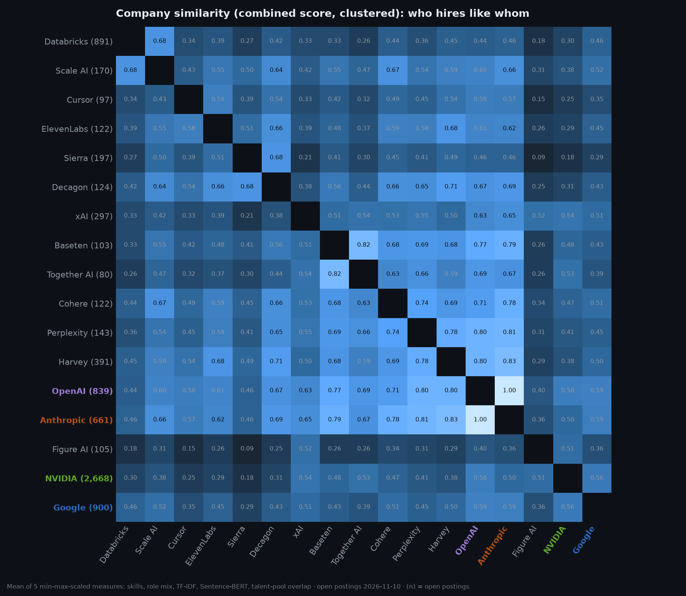
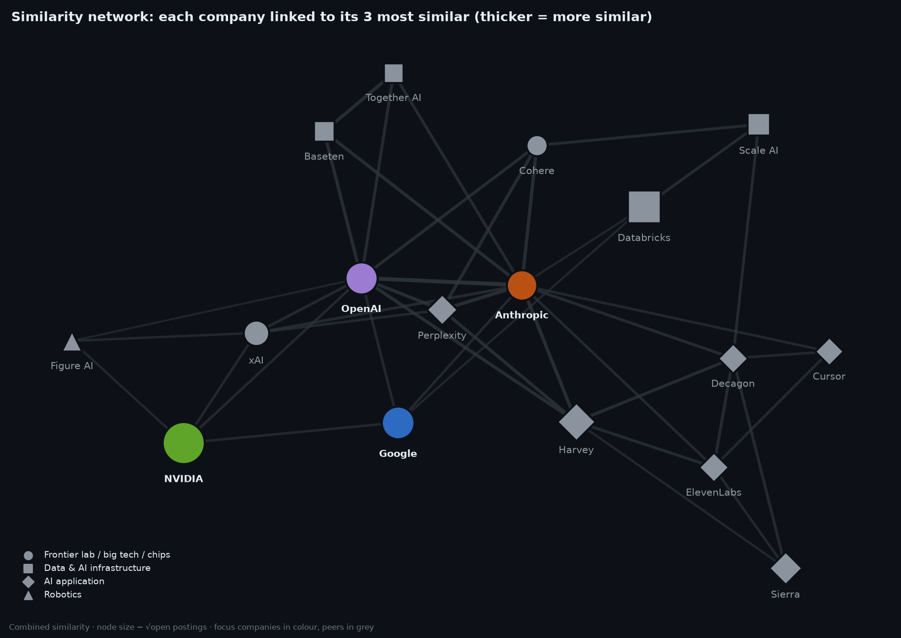
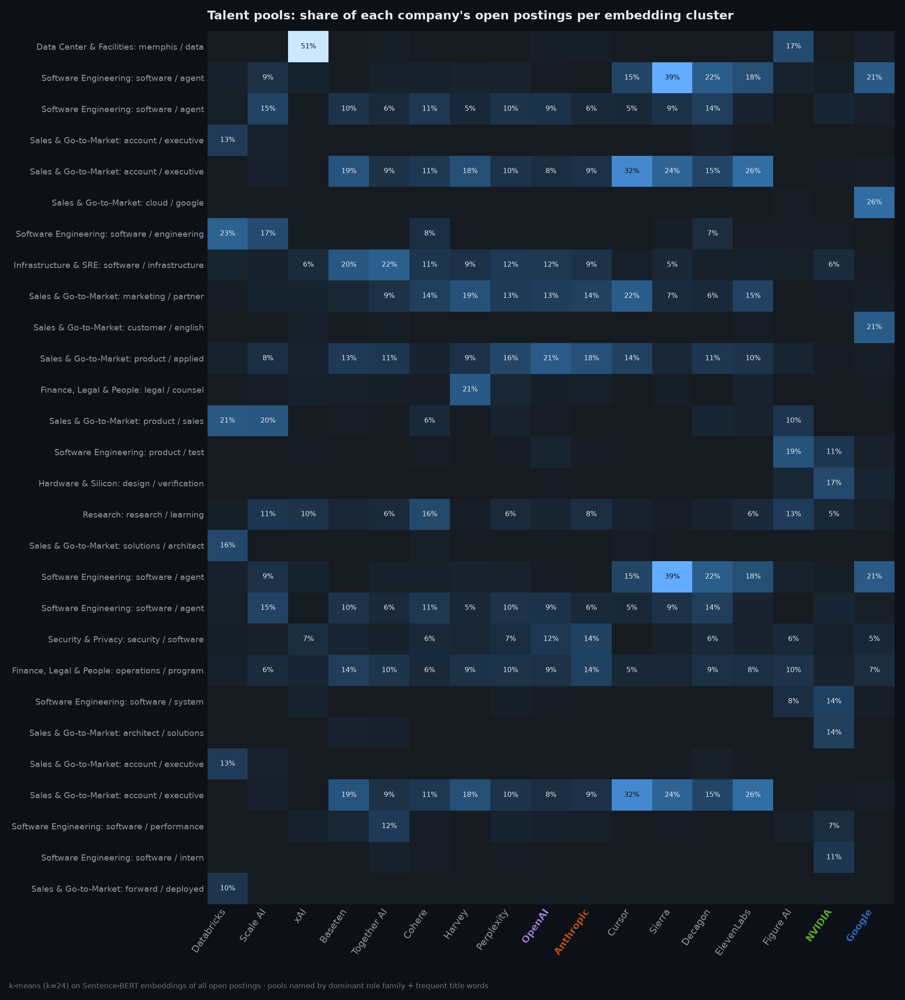

# Company Similarity Summary (generated)

Generated by `python -m src.similarity.build_similarity` · 17 companies · 7,921 open postings (3,989 technical) · see [Sprint 8](../../docs/sprints/sprint-08-similarity-scoring.md)

## Nearest neighbours

| Company | Segment | Open postings | Most similar (combined) |
|---|---|---:|---|
| 🟢 NVIDIA | Semiconductors | 2,668 | 🟣 OpenAI 0.58 · 🔵 Google 0.55 · xAI 0.55 |
| 🔵 Google | Big tech | 911 | 🟣 OpenAI 0.59 · 🟠 Anthropic 0.57 · 🟢 NVIDIA 0.55 |
| Databricks | Data & AI infrastructure | 891 | Scale AI 0.67 · 🔵 Google 0.47 · 🟠 Anthropic 0.46 |
| 🟣 OpenAI | Frontier lab | 839 | 🟠 Anthropic 1.00 · Perplexity 0.81 · Harvey 0.79 |
| 🟠 Anthropic | Frontier lab | 661 | 🟣 OpenAI 1.00 · Perplexity 0.83 · Harvey 0.83 |
| Harvey | AI application | 391 | 🟠 Anthropic 0.83 · 🟣 OpenAI 0.79 · Perplexity 0.77 |
| xAI | Frontier lab | 297 | 🟠 Anthropic 0.65 · 🟣 OpenAI 0.63 · Perplexity 0.56 |
| Sierra | AI application | 197 | Decagon 0.66 · ElevenLabs 0.57 · Harvey 0.52 |
| Scale AI | Data & AI infrastructure | 170 | Cohere 0.67 · Databricks 0.67 · Decagon 0.66 |
| Perplexity | AI application | 143 | 🟠 Anthropic 0.83 · 🟣 OpenAI 0.81 · Harvey 0.77 |
| Decagon | AI application | 124 | Harvey 0.72 · ElevenLabs 0.68 · 🟠 Anthropic 0.68 |
| Cohere | Frontier lab | 122 | 🟠 Anthropic 0.80 · Perplexity 0.76 · 🟣 OpenAI 0.73 |
| ElevenLabs | AI application | 122 | Decagon 0.68 · Harvey 0.67 · 🟠 Anthropic 0.61 |
| Figure AI | Robotics | 105 | xAI 0.53 · 🟢 NVIDIA 0.51 · 🟣 OpenAI 0.40 |
| Baseten | Data & AI infrastructure | 103 | Together AI 0.81 · 🟠 Anthropic 0.79 · 🟣 OpenAI 0.76 |
| Cursor | AI application | 97 | ElevenLabs 0.59 · Decagon 0.57 · 🟠 Anthropic 0.56 |
| Together AI | Data & AI infrastructure | 80 | Baseten 0.81 · 🟣 OpenAI 0.71 · 🟠 Anthropic 0.69 |

## Focus-company pairs: what drives similarity

| Pair | Combined | Shared skills (share a/b) | Biggest differences |
|---|---:|---|---|
| 🟠 Anthropic – 🟣 OpenAI | 1.00 | Startup / Ambiguity (58%/69%) · Python (50%/38%) · AI Agents (33%/35%) · Machine Learning (51%/29%) · Large Language Models (46%/27%) | 🟠 Anthropic more: Machine Learning, Large Language Models, Python — 🟣 OpenAI more: APIs, Observability, Startup / Ambiguity |
| 🟠 Anthropic – 🟢 NVIDIA | 0.50 | Python (50%/53%) · Communication Skills (32%/32%) · Machine Learning (51%/20%) · AI Agents (33%/18%) · Large Language Models (46%/15%) | 🟠 Anthropic more: Startup / Ambiguity, Machine Learning, Large Language Models — 🟢 NVIDIA more: GPU, C++, ASIC / SoC Design |
| 🟠 Anthropic – 🔵 Google | 0.57 | Python (50%/41%) · Machine Learning (51%/40%) · Technical Leadership (24%/27%) · Cross-functional Collaboration (23%/41%) · Distributed Systems (25%/22%) | 🟠 Anthropic more: Startup / Ambiguity, Large Language Models, Communication Skills — 🔵 Google more: C++, Cross-functional Collaboration, Java |
| 🟣 OpenAI – 🟢 NVIDIA | 0.58 | Python (38%/53%) · Communication Skills (20%/32%) · Machine Learning (29%/20%) · AI Agents (35%/18%) · Networking (18%/33%) | 🟣 OpenAI more: Startup / Ambiguity, APIs, Observability — 🟢 NVIDIA more: GPU, C++, Deep Learning |
| 🟣 OpenAI – 🔵 Google | 0.59 | Python (38%/41%) · Cross-functional Collaboration (34%/41%) · Machine Learning (29%/40%) · Distributed Systems (25%/22%) · Startup / Ambiguity (69%/18%) | 🟣 OpenAI more: Startup / Ambiguity, APIs, Observability — 🔵 Google more: Google Cloud, C++, Java |
| 🟢 NVIDIA – 🔵 Google | 0.55 | Python (53%/41%) · C++ (37%/32%) · Machine Learning (20%/40%) · AI Agents (18%/17%) · Networking (33%/16%) | 🟢 NVIDIA more: GPU, Communication Skills, HPC — 🔵 Google more: Cross-functional Collaboration, Google Cloud, Machine Learning |

## Top 15 most similar pairs (all companies)

| a          | b           |   skills |   role_mix |   tfidf |   embedding |   talent |   combined |
|:-----------|:------------|---------:|-----------:|--------:|------------:|---------:|-----------:|
| 🟣 OpenAI     | 🟠 Anthropic   |   0.9025 |     0.8258 |  0.7205 |      0.9522 |   0.8464 |     0.998  |
| 🟠 Anthropic  | Perplexity  |   0.8435 |     0.4766 |  0.6207 |      0.9524 |   0.8059 |     0.8267 |
| 🟠 Anthropic  | Harvey      |   0.8796 |     0.6562 |  0.5541 |      0.9505 |   0.6393 |     0.8251 |
| Baseten    | Together AI |   0.8149 |     0.6883 |  0.5224 |      0.9146 |   0.7745 |     0.8131 |
| 🟣 OpenAI     | Perplexity  |   0.8018 |     0.4419 |  0.6034 |      0.9546 |   0.8368 |     0.8075 |
| 🟠 Anthropic  | Cohere      |   0.8717 |     0.7249 |  0.5025 |      0.9199 |   0.6316 |     0.8006 |
| 🟣 OpenAI     | Harvey      |   0.8551 |     0.6372 |  0.5483 |      0.9377 |   0.6098 |     0.791  |
| 🟠 Anthropic  | Baseten     |   0.8252 |     0.6495 |  0.5772 |      0.9044 |   0.6747 |     0.7857 |
| Harvey     | Perplexity  |   0.8508 |     0.5308 |  0.4962 |      0.9463 |   0.6843 |     0.7672 |
| 🟣 OpenAI     | Baseten     |   0.7902 |     0.691  |  0.5384 |      0.8913 |   0.6725 |     0.764  |
| Perplexity | Cohere      |   0.8297 |     0.5818 |  0.427  |      0.9345 |   0.7217 |     0.7552 |
| 🟣 OpenAI     | Cohere      |   0.7537 |     0.7007 |  0.455  |      0.8986 |   0.6374 |     0.725  |
| Harvey     | Decagon     |   0.7725 |     0.77   |  0.3574 |      0.9288 |   0.5498 |     0.7216 |
| Harvey     | Cohere      |   0.8235 |     0.6378 |  0.3956 |      0.9186 |   0.5791 |     0.7082 |
| 🟣 OpenAI     | Together AI |   0.6495 |     0.595  |  0.5281 |      0.9216 |   0.6605 |     0.7077 |

## How much do the measures agree? (Spearman correlation across pairs)

|           |   skills |   role_mix |   tfidf |   embedding |   talent |
|:----------|---------:|-----------:|--------:|------------:|---------:|
| skills    |     1    |       0.4  |    0.66 |        0.74 |     0.57 |
| role_mix  |     0.4  |       1    |    0.2  |        0.18 |     0.31 |
| tfidf     |     0.66 |       0.2  |    1    |        0.42 |     0.1  |
| embedding |     0.74 |       0.18 |    0.42 |        1    |     0.69 |
| talent    |     0.57 |       0.31 |    0.1  |        0.69 |     1    |

## Talent pools

