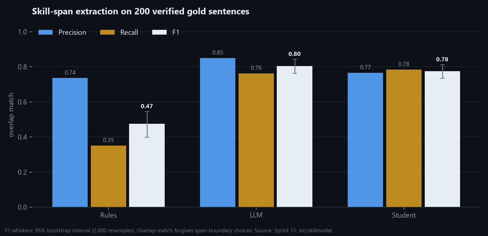

# Skill-span extraction: rules vs LLM vs fine-tuned student

_Generated by `python -m src.skillmodel.report`. Gold: 200 held-out sentences, 422 spans, verified by the project owner. Overlap match forgives boundary choices; exact match does not; "strict" removes 19 owner-added spans the guidelines exclude._

| System | Precision | Recall | F1 (95% CI) | Exact F1 | Strict F1 |
|---|---:|---:|---:|---:|---:|
| Rules (Sprint 4 taxonomy) | 0.74 | 0.35 | **0.47** (0.40–0.54) | 0.32 | 0.47 |
| LLM (gpt-oss-120b, zero-shot) | 0.85 | 0.76 | **0.80** (0.76–0.84) | 0.72 | 0.81 |
| student: llm-roberta-base | 0.77 | 0.78 | **0.78** (0.73–0.81) | 0.64 | 0.77 |
| student: llm-deberta-v3-base | 0.75 | 0.78 | **0.77** (0.73–0.81) | 0.63 | 0.76 |
| student: llm-jobbert-base-cased | 0.77 | 0.75 | **0.76** (0.72–0.80) | 0.59 | 0.76 |
| student: union-roberta-base | 0.72 | 0.81 | **0.76** (0.72–0.80) | 0.62 | 0.76 |
| student: rules-roberta-base | 0.74 | 0.37 | **0.49** (0.41–0.57) | 0.34 | 0.49 |

- Best student **skill-llm-roberta-base** vs rules: F1 difference +0.30 (95% CI +0.24 to +0.37); vs LLM: -0.03 (-0.06 to +0.00).
- Speed: the student tags about **1,134 sentences/second** on the laptop GPU; the free LLM tier labelled 1,257 sentences before its daily limit.
- 60 frequent skill spans found by the student that no taxonomy rule matches: [new_skill_candidates.csv](new_skill_candidates.csv).
