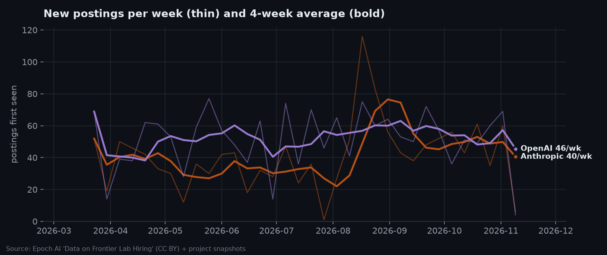
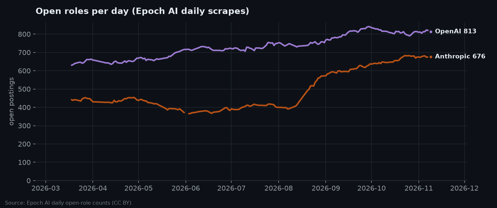
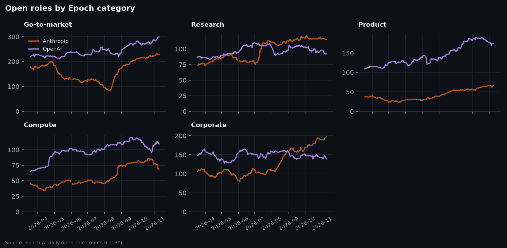
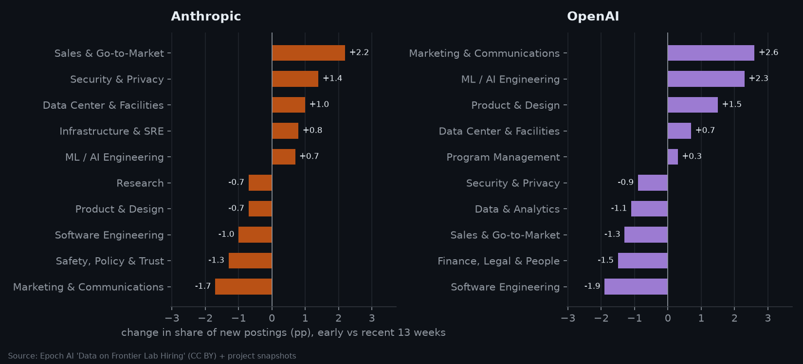
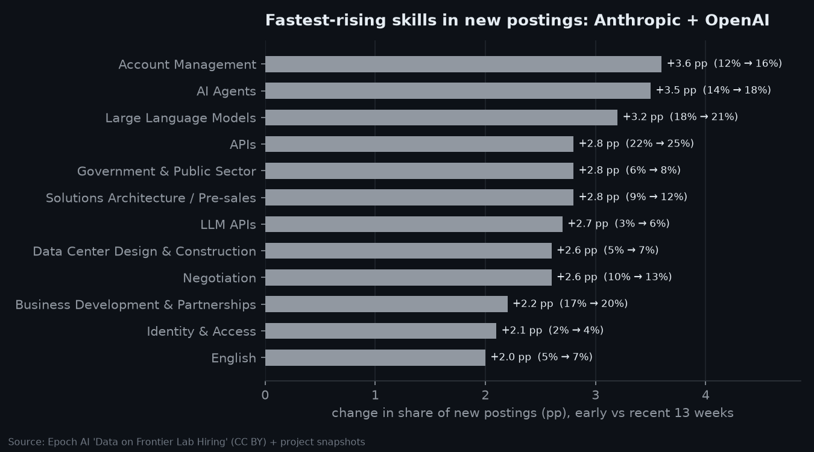
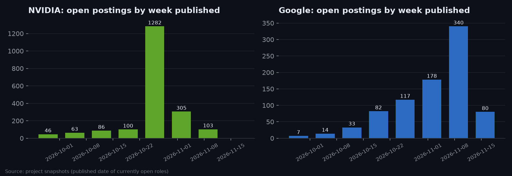

# Hiring Trends Summary (generated)

Generated by `python -m src.trends.build_trends` · data through 2026-11-19 · see [Sprint 5](../../docs/sprints/sprint-05-hiring-trends.md)

## 🟠 Anthropic & 🟣 OpenAI: weekly flows (Epoch history + our snapshots)

| company     |   weeks |   total_new |   mean_new_per_week |   total_closed |   open_roles_start |   open_roles_latest | open_roles_change   |   last_4wk_avg |   prior_4wk_avg |
|:------------|--------:|------------:|--------------------:|---------------:|-------------------:|--------------------:|:--------------------|---------------:|----------------:|
| 🟠 Anthropic |      34 |        1396 |                41.1 |           1205 |                442 |                 676 | +53%                |           40.5 |            49.8 |
| 🟣 OpenAI    |      34 |        1751 |                51.5 |           1619 |                630 |                 813 | +29%                |           45.5 |            54   |

> Epoch's daily scrapes have gaps (up to 8 days). Postings published during a gap are first seen on the next scrape, so single weeks are lumpy. 3 weeks had fewer than 4 scrape days (`low_coverage` in the weekly table). Read the 4-week average.

## Role mix shift (early vs recent 13 weeks)

| role_family                |   🟠 Anthropic |   🟣 OpenAI |
|:---------------------------|------------:|---------:|
| Sales & Go-to-Market       |         2.2 |     -1.3 |
| Security & Privacy         |         1.4 |     -0.9 |
| Data Center & Facilities   |         1   |      0.7 |
| Infrastructure & SRE       |         0.8 |     -0.8 |
| ML / AI Engineering        |         0.7 |      2.3 |
| Hardware & Silicon         |         0.3 |      0.2 |
| Other                      |        -0.1 |      0.2 |
| Program Management         |        -0.3 |      0.3 |
| Data & Analytics           |        -0.4 |     -1.1 |
| Finance, Legal & People    |        -0.5 |     -1.5 |
| Research                   |        -0.7 |      0.2 |
| Product & Design           |        -0.7 |      1.5 |
| Software Engineering       |        -1   |     -1.9 |
| Safety, Policy & Trust     |        -1.3 |     -0.4 |
| Marketing & Communications |        -1.7 |      2.6 |

## Emerging skills

| skill                               | category                    | early_share   | recent_share   |   change_pp |   ratio |   recent_postings |
|:------------------------------------|:----------------------------|:--------------|:---------------|------------:|--------:|------------------:|
| Account Management                  | Go-to-Market & Sales        | 12.1%         | 15.7%          |         3.6 |    1.3  |               235 |
| AI Agents                           | LLM & Generative AI         | 14.0%         | 17.5%          |         3.5 |    1.25 |               262 |
| Large Language Models               | LLM & Generative AI         | 17.7%         | 20.9%          |         3.2 |    1.18 |               313 |
| APIs                                | Web, Mobile & APIs          | 21.8%         | 24.6%          |         2.8 |    1.13 |               368 |
| Government & Public Sector          | Finance, Legal & Operations | 5.6%          | 8.4%           |         2.8 |    1.49 |               125 |
| Solutions Architecture / Pre-sales  | Go-to-Market & Sales        | 9.0%          | 11.8%          |         2.8 |    1.31 |               176 |
| LLM APIs                            | LLM & Generative AI         | 3.2%          | 5.9%           |         2.7 |    1.83 |                88 |
| Data Center Design & Construction   | Data Center & Facilities    | 4.6%          | 7.1%           |         2.6 |    1.56 |               107 |
| Negotiation                         | Leadership & Collaboration  | 10.0%         | 12.6%          |         2.6 |    1.26 |               188 |
| Business Development & Partnerships | Go-to-Market & Sales        | 17.4%         | 19.6%          |         2.2 |    1.12 |               293 |
| Identity & Access                   | Security & Compliance       | 2.4%          | 4.5%           |         2.1 |    1.88 |                67 |
| English                             | Spoken Languages            | 4.9%          | 6.9%           |         2   |    1.4  |               104 |

## Posting lifetime (closed postings)

Median days a posting stays up before closing: Anthropic **41**, OpenAI **41**. Lifetime here is first seen → last seen, i.e. how long a role stays open.

| role_family                |   🟠 Anthropic |   🟣 OpenAI |
|:---------------------------|------------:|---------:|
| All roles                  |          41 |       41 |
| Data & Analytics           |          26 |       38 |
| Data Center & Facilities   |          58 |       50 |
| Finance, Legal & People    |          42 |       45 |
| Hardware & Silicon         |         nan |       67 |
| Infrastructure & SRE       |          47 |       51 |
| ML / AI Engineering        |          64 |       62 |
| Marketing & Communications |          44 |       32 |
| Other                      |         nan |       52 |
| Product & Design           |          41 |       26 |
| Program Management         |          36 |       35 |
| Research                   |          54 |       31 |
| Safety, Policy & Trust     |          39 |       44 |
| Sales & Go-to-Market       |          36 |       41 |
| Security & Privacy         |          42 |       59 |
| Software Engineering       |          47 |       42 |

## 🟢 NVIDIA & 🔵 Google: recent posting velocity (published date, open roles only)

| week       |   🔵 Google |   🟢 NVIDIA |
|:-----------|---------:|---------:|
| 2026-09-28 |        4 |       46 |
| 2026-10-05 |       10 |       63 |
| 2026-10-12 |       21 |       86 |
| 2026-10-19 |       59 |      100 |
| 2026-10-26 |       87 |     1282 |
| 2026-11-02 |      130 |      305 |
| 2026-11-09 |      212 |      103 |
| 2026-11-16 |      348 |        0 |

> Survivorship-biased: only roles still open are visible, so older weeks are under-counted. Real flows for NVIDIA and Google come from our weekly snapshots, which accumulate from 2026-11-08.

## Weekly table

| week       | company   |   new_postings |   closed |   active |   scrape_days | low_coverage   |   new_4wk_avg |   net_change | hiring_velocity_bucket   |
|:-----------|:----------|---------------:|---------:|---------:|--------------:|:---------------|--------------:|-------------:|:-------------------------|
| 2026-03-16 | 🟠 Anthropic |            nan |       15 |      453 |             3 | True           |         nan   |          nan |                          |
| 2026-03-23 | 🟠 Anthropic |             52 |       41 |      490 |             6 | False          |          52   |           11 | high                     |
| 2026-03-30 | 🟠 Anthropic |             19 |       57 |      468 |             4 | False          |          35.5 |          -38 | low                      |
| 2026-04-06 | 🟠 Anthropic |             50 |        9 |      461 |             2 | True           |          40.3 |           41 | high                     |
| 2026-04-13 | 🟠 Anthropic |             46 |       27 |      498 |             7 | False          |          41.8 |           19 | medium                   |
| 2026-04-20 | 🟠 Anthropic |             42 |       25 |      513 |             5 | False          |          39.2 |           17 | medium                   |
| 2026-04-27 | 🟠 Anthropic |             33 |       35 |      521 |             7 | False          |          42.8 |           -2 | low                      |
| 2026-05-04 | 🟠 Anthropic |             30 |       47 |      516 |             5 | False          |          37.8 |          -17 | low                      |
| 2026-05-11 | 🟠 Anthropic |             12 |       49 |      481 |             4 | False          |          29.2 |          -37 | low                      |
| 2026-05-18 | 🟠 Anthropic |             36 |       31 |      468 |             4 | False          |          27.8 |            5 | medium                   |
| 2026-05-25 | 🟠 Anthropic |             30 |       72 |      467 |             5 | False          |          27   |          -42 | low                      |
| 2026-06-01 | 🟠 Anthropic |             42 |       20 |      437 |             5 | False          |          30   |           22 | medium                   |
| 2026-06-08 | 🟠 Anthropic |             43 |       17 |      460 |             4 | False          |          37.8 |           26 | medium                   |
| 2026-06-15 | 🟠 Anthropic |             18 |       27 |      461 |             4 | False          |          33.2 |           -9 | low                      |
| 2026-06-22 | 🟠 Anthropic |             32 |       16 |      466 |             5 | False          |          33.8 |           16 | low                      |
| 2026-06-29 | 🟠 Anthropic |             28 |       30 |      478 |             7 | False          |          30.2 |           -2 | low                      |
| 2026-07-06 | 🟠 Anthropic |             47 |       34 |      495 |             7 | False          |          31.2 |           13 | medium                   |
| 2026-07-13 | 🟠 Anthropic |             24 |       26 |      485 |             6 | False          |          32.8 |           -2 | low                      |
| 2026-07-20 | 🟠 Anthropic |             36 |       22 |      495 |             5 | False          |          33.8 |           14 | medium                   |
| 2026-07-27 | 🟠 Anthropic |              1 |       30 |      474 |             7 | False          |          27   |          -29 | low                      |
| 2026-08-03 | 🟠 Anthropic |             27 |       36 |      471 |             4 | False          |          22   |           -9 | low                      |
| 2026-08-10 | 🟠 Anthropic |             51 |       32 |      486 |             3 | True           |          28.8 |           19 | high                     |
| 2026-08-17 | 🟠 Anthropic |            116 |        6 |      570 |             4 | False          |          48.8 |          110 | high                     |
| 2026-08-24 | 🟠 Anthropic |             83 |       32 |      647 |             7 | False          |          69.2 |           51 | high                     |
| 2026-08-31 | 🟠 Anthropic |             56 |       49 |      671 |             7 | False          |          76.5 |            7 | high                     |
| 2026-09-07 | 🟠 Anthropic |             43 |       35 |      665 |             7 | False          |          74.5 |            8 | medium                   |
| 2026-09-14 | 🟠 Anthropic |             38 |       24 |      668 |             7 | False          |          55   |           14 | medium                   |
| 2026-09-21 | 🟠 Anthropic |             48 |       42 |      692 |             7 | False          |          46.2 |            6 | high                     |
| 2026-09-28 | 🟠 Anthropic |             52 |       40 |      702 |             7 | False          |          45.2 |           12 | high                     |
| 2026-10-05 | 🟠 Anthropic |             56 |       50 |      718 |             7 | False          |          48.5 |            6 | high                     |
| 2026-10-12 | 🟠 Anthropic |             43 |       38 |      711 |             7 | False          |          49.8 |            5 | medium                   |
| 2026-10-19 | 🟠 Anthropic |             61 |       41 |      734 |             7 | False          |          53   |           20 | high                     |
| 2026-10-26 | 🟠 Anthropic |             35 |       48 |      728 |             7 | False          |          48.8 |          -13 | medium                   |
| 2026-11-02 | 🟠 Anthropic |             60 |       65 |      740 |             7 | False          |          49.8 |           -5 | high                     |
| 2026-11-09 | 🟠 Anthropic |              6 |       52 |      681 |             1 | False          |          40.5 |          -46 | low                      |
| 2026-03-16 | 🟣 OpenAI    |            nan |       11 |      650 |             3 | True           |         nan   |          nan |                          |
| 2026-03-23 | 🟣 OpenAI    |             69 |       30 |      708 |             6 | False          |          69   |           39 | high                     |
| 2026-03-30 | 🟣 OpenAI    |             14 |       56 |      692 |             4 | False          |          41.5 |          -42 | low                      |
| 2026-04-06 | 🟣 OpenAI    |             39 |        9 |      675 |             2 | True           |          40.7 |           30 | low                      |
| 2026-04-13 | 🟣 OpenAI    |             38 |       28 |      704 |             7 | False          |          40   |           10 | low                      |
| 2026-04-20 | 🟣 OpenAI    |             62 |       50 |      738 |             5 | False          |          38.2 |           12 | high                     |
| 2026-04-27 | 🟣 OpenAI    |             61 |       37 |      749 |             7 | False          |          50   |           24 | medium                   |
| 2026-05-04 | 🟣 OpenAI    |             53 |       58 |      765 |             5 | False          |          53.5 |           -5 | medium                   |
| 2026-05-11 | 🟣 OpenAI    |             28 |       47 |      735 |             4 | False          |          51   |          -19 | low                      |
| 2026-05-18 | 🟣 OpenAI    |             59 |       24 |      747 |             4 | False          |          50.2 |           35 | medium                   |
| 2026-05-25 | 🟣 OpenAI    |             77 |       26 |      800 |             5 | False          |          54.2 |           51 | high                     |
| 2026-06-01 | 🟣 OpenAI    |             57 |       73 |      831 |             5 | False          |          55.2 |          -16 | medium                   |
| 2026-06-08 | 🟣 OpenAI    |             48 |       28 |      806 |             4 | False          |          60.2 |           20 | low                      |
| 2026-06-15 | 🟣 OpenAI    |             37 |       67 |      815 |             4 | False          |          54.8 |          -30 | low                      |
| 2026-06-22 | 🟣 OpenAI    |             63 |       38 |      811 |             5 | False          |          51.2 |           25 | high                     |
| 2026-06-29 | 🟣 OpenAI    |             14 |       21 |      787 |             7 | False          |          40.5 |           -7 | low                      |
| 2026-07-06 | 🟣 OpenAI    |             74 |       51 |      840 |             7 | False          |          47   |           23 | high                     |
| 2026-07-13 | 🟣 OpenAI    |             36 |       50 |      825 |             6 | False          |          46.8 |          -14 | low                      |
| 2026-07-20 | 🟣 OpenAI    |             70 |       38 |      845 |             5 | False          |          48.5 |           32 | high                     |
| 2026-07-27 | 🟣 OpenAI    |             46 |       77 |      853 |             7 | False          |          56.5 |          -31 | low                      |
| 2026-08-03 | 🟣 OpenAI    |             65 |       67 |      841 |             4 | False          |          54.2 |           -2 | high                     |
| 2026-08-10 | 🟣 OpenAI    |             41 |       63 |      815 |             3 | True           |          55.5 |          -22 | low                      |
| 2026-08-17 | 🟣 OpenAI    |             75 |       11 |      827 |             4 | False          |          56.8 |           64 | high                     |
| 2026-08-24 | 🟣 OpenAI    |             60 |       51 |      876 |             7 | False          |          60.2 |            9 | medium                   |
| 2026-08-31 | 🟣 OpenAI    |             64 |       46 |      889 |             7 | False          |          60   |           18 | high                     |
| 2026-09-07 | 🟣 OpenAI    |             53 |       42 |      896 |             7 | False          |          63   |           11 | medium                   |
| 2026-09-14 | 🟣 OpenAI    |             50 |       44 |      904 |             7 | False          |          56.8 |            6 | medium                   |
| 2026-09-21 | 🟣 OpenAI    |             72 |       61 |      932 |             7 | False          |          59.8 |           11 | high                     |
| 2026-09-28 | 🟣 OpenAI    |             57 |       54 |      928 |             7 | False          |          58   |            3 | medium                   |
| 2026-10-05 | 🟣 OpenAI    |             36 |       56 |      910 |             7 | False          |          53.8 |          -20 | low                      |
| 2026-10-12 | 🟣 OpenAI    |             51 |       52 |      905 |             7 | False          |          54   |           -1 | medium                   |
| 2026-10-19 | 🟣 OpenAI    |             49 |       77 |      902 |             7 | False          |          48.2 |          -28 | medium                   |
| 2026-10-26 | 🟣 OpenAI    |             60 |       49 |      885 |             7 | False          |          49   |           11 | medium                   |
| 2026-11-02 | 🟣 OpenAI    |             69 |       79 |      905 |             7 | False          |          57.2 |          -10 | high                     |
| 2026-11-09 | 🟣 OpenAI    |              4 |       59 |      830 |             1 | False          |          45.5 |          -55 | low                      |
